# Sistema de Recomendación Biomecánica — Catálogo de Ejercicios

**Asignatura:** MLY1101 Machine Learning — Duoc UC
**Evaluación:** EV2 — Modelado y evaluación (sobre la base de la EV1: comprensión del
negocio, comprensión de los datos y preparación)
**Metodología:** CRISP-DM (fases 1 a 5)
**Repositorio:** `Unknumb/proyecto_gym`

---

> ### Alcance de la entrega
> - **EV1 (§1–§10): fases 1, 2 y 3 de CRISP-DM**, sin entrenar modelos. Fue una decisión
>   deliberada contra el *"salto al vacío"*: modelar antes de comprender y preparar los
>   datos produce sistemas que optimizan métricas sobre supuestos no verificados.
> - **EV2 (§11–§14): fases 4 (modelado) y 5 (evaluación).** Integra dos fuentes nuevas
>   (§11), entrena y compara dos modelos supervisados (§12) y dos técnicas no supervisadas
>   (§13), y evalúa el resultado contra los KPIs de negocio (§14).
> - **Fase 6 (despliegue): fuera de alcance.** §7 describe su diseño.

### Guía de lectura para la EV2

| Lo que pide la pauta | Dónde está |
|---|---|
| Problema de negocio, objetivos y KPIs | §1.1, §1.2, §1.3 (con los resultados de la EV2) |
| Fuentes de datos | §2.1, §11.1 |
| Preparación y análisis exploratorio (EDA) | §3, §4, §11 · `notebooks/01_exploratory_data_analysis.ipynb` |
| Metodología CRISP-DM | §1.4 |
| Ética y sesgos | §5 (datos) y §14.3 (después del modelado) |
| Modelos supervisados (IE6) | §12 · `notebooks/02_modelado_supervisado.ipynb` |
| Modelos no supervisados (IE7) | §13 · `notebooks/03_modelado_no_supervisado.ipynb` |
| Interpretación y recomendaciones de negocio (IE8) | §12.3–§12.6, §13.3–§13.6, §14 |
| Reproducibilidad y estructura del proyecto | §8 |

---

## 1. Contexto de negocio

### 1.1 El problema

Las aplicaciones de fitness masivas recomiendan ejercicios por **similitud de texto o
por popularidad**, no por mecánica corporal. Esto genera un fallo concreto y frecuente:
un usuario con una limitación articular —tendinitis rotuliana, pinzamiento de hombro,
lumbalgia— recibe como "alternativa" a una sentadilla otro movimiento que carga
exactamente la misma articulación comprometida, porque ambos comparten la etiqueta
*"pierna"*.

### 1.2 La propuesta

Construir un sistema que modele el ejercicio como una **estructura biomecánica** —qué
músculo agonista trabaja, qué sinergistas recluta, qué articulaciones compromete, qué
equipamiento exige— y que permita **enmascarar articulaciones lesionadas** para
encontrar sustitutos mecánicamente equivalentes.

**Objetivo general.** Recomendar, para cualquier ejercicio del catálogo, alternativas que
trabajen el mismo músculo con el mismo patrón de movimiento **sin cargar una articulación
lesionada**, y abstenerse cuando no exista una alternativa segura.

**Objetivos específicos.**

1. Integrar el catálogo con fuentes abiertas en un solo grafo, con un vocabulario
   muscular común y sin duplicados entre fuentes (§3, §11).
2. Completar con **modelos supervisados** las etiquetas que el catálogo no trae: mecánica,
   tipo de fuerza y complejidad técnica (§12).
3. Descubrir con **aprendizaje no supervisado** las familias de movimiento del catálogo
   (§13).
4. Medir cuántas alternativas reales tiene un ejercicio cuando se veta una articulación,
   y abstenerse cuando no las hay (§13.5).
5. Medir y mitigar los sesgos de los datos y de los modelos (§5, §14.3).

### 1.3 KPIs y resultados

| KPI | Definición | Meta | Resultado (EV2) |
|---|---|---|---|
| **Cobertura de sustitución** | % de ejercicios con ≥3 alternativas que preservan el músculo objetivo y excluyen la articulación vetada | ≥ 85 % | ✅ **89,4 %** de los ejercicios sustituibles, con alternativas de su misma familia de movimiento (§13.5). Bajo la meta: hombro 79,6 %, rodilla 69,3 %, cadera 83,6 %. El 39,9 % de los casos no tiene sustituto por anatomía y el sistema se abstiene |
| Precisión de la jerarquía muscular | % de registros con agonista y sinergistas correctamente asignados | 100 % (auditado) | ✅ 100 % tras la corrección de la EV1 (§3.3) |
| Cobertura por grupo muscular | Nº mínimo de ejercicios por músculo primario | ≥ 10 | ⚠️ 4 grupos incumplían en el catálogo (EV1) → **2** con las tres fuentes (`levator scapulae` 2, `neck` 7). La abstención de §5.1 b los cubre (§13.5) |
| Etiquetas del perfil con confianza *(nuevo)* | % del catálogo con mecánica / fuerza asignadas | — | 0 % → **85,5 % / 95,5 %** (§12.4) |
| Calidad de los modelos supervisados *(nuevo)* | F1 macro en test, mecánica y fuerza | ≥ 0,85 | ✅ 0,88 / 0,88 (§12.3) |
| Acierto de lo etiquetado en el catálogo *(nuevo)* | % de etiquetas correctas, validación externa | ≥ 90 % | ⚠️ 89,8 % / 88,5 %: en el límite, con ~60 casos (±8 puntos) (§12.4) |
| Latencia de inferencia en dispositivo | FPS de análisis de postura en tiempo real | ≥ 30 FPS | No medido: requiere la aplicación (fase 6, §7) |
| Fuga de datos biométricos | Fotogramas de vídeo enviados a servidores externos | **0** | ✅ 0 por diseño: ningún componente procesa vídeo del usuario |

El KPI de cobertura por grupo muscular **sigue sin cumplirse**: el EDA lo detectó (§4.1) y
las fuentes nuevas lo redujeron de 4 a 2 grupos. Para esos grupos el sistema se abstiene
en vez de recomendar con pocas opciones.

**Qué decide cada modelo y cuánto cuesta equivocarse.** Se fijó antes de entrenar, y es lo
que justifica fallar hacia la abstención (§5.3):

| | Etiquetas del perfil (§12) | Sustitución (§13) |
|---|---|---|
| Decisión | Asignar mecánica, fuerza y complejidad técnica, o dejar la etiqueta vacía | Proponer hasta 5 alternativas, o abstenerse |
| Quién la usa | El recomendador, para filtrar y sustituir; un profesional puede corregirla | El usuario con una articulación lesionada, idealmente con su kinesiólogo |
| Error grave | Etiqueta falsa: a un principiante le llega un ejercicio técnico, o se sustituye por otro patrón de movimiento | Alternativa que carga la articulación lesionada |
| Error leve | Abstenerse: el ejercicio queda fuera del filtro hasta que alguien lo etiquete | Abstenerse: "no hay un sustituto seguro, consulta a un profesional" |
| Criterio de éxito | F1 macro ≥ 0,85 en test y ≥ 90 % de acierto en lo etiquetado | ≥ 85 % de los ejercicios con ≥ 3 alternativas seguras de su familia |

Como el error grave cuesta mucho más que el leve, los dos modelos se calibran para
abstenerse antes que equivocarse: umbral de confianza con 95 % de acierto (§12.2) y
exclusión dura de la articulación vetada (§13.5).

### 1.4 Metodología (CRISP-DM)

El proyecto sigue **CRISP-DM** (*Cross-Industry Standard Process for Data Mining*), el
estándar de facto para estructurar un proyecto de ciencia de datos en seis fases:

| Fase | Objetivo | Estado |
|---|---|---|
| 1. Comprensión del negocio | Definir el problema, los objetivos y los KPIs de éxito | **Cerrada** (EV1, actualizada en EV2) — §1 |
| 2. Comprensión de los datos | Relevar las fuentes, su estructura, calidad y limitaciones | **Cerrada** — §2, §4, §11.5 |
| 3. Preparación de los datos | Limpiar, transformar e integrar los datos para el modelamiento | **Cerrada** — §3, §11 |
| 4. Modelado | Entrenar y ajustar modelos | **Cerrada (EV2)** — supervisado §12, no supervisado §13 |
| 5. Evaluación | Validar los modelos contra los KPIs de negocio | **Cerrada (EV2)** — §12.3–§12.5, §13.3–§13.5, §14 |
| 6. Despliegue | Poner el modelo en producción y monitorearlo | Fuera de alcance — diseño en §7 |

**Por qué la EV1 no saltó a la fase 4.** La entrega respeta el orden secuencial de CRISP-DM
a propósito: modelar antes de cerrar las fases 1–3 es el *"salto al vacío"* señalado en
la advertencia de alcance (arriba). La auditoría de calidad de datos (§3.3, §3.5) y de
los recursos cinemáticos (§4.4) encontró defectos —jerarquía muscular invertida,
corrupción de la llave primaria, falsos positivos de emparejamiento, un corpus de vídeo
no entrenable— que habrían invalidado cualquier modelo entrenado antes de detectarlos.
CRISP-DM es iterativo, no lineal: los hallazgos de la fase 2 (§4) obligaron a repetir
pasos de la fase 3 (§3.3, §3.5) antes de darla por cerrada, y la evaluación ética (§5) se
trató como parte de la comprensión del negocio y de los datos, no como un paso posterior.

El §5 (ética, sesgos y privacidad) y el §6 (limitaciones) atraviesan las fases en lugar
de pertenecer a una sola: el sesgo de muestreo se detecta en la comprensión de los datos
(§4) pero se declara y mitiga desde la comprensión del negocio (§1, §5.1), y se vuelve a
medir después de modelar (§14.3).

**Cómo iteró CRISP-DM en la EV2.** Tres veces la evaluación obligó a volver atrás:

1. **Evaluación de los datos → comprensión del negocio.** El nivel de dificultad de
   megaGymDataset y el de free-exercise-db coinciden igual que al azar (kappa = −0,01,
   §11.5). Se dejó de predecir "dificultad" y se redefinió el objetivo como un **perfil
   de exigencia** (§12.1).
2. **Evaluación → modelado.** La demostración de sustitución proponía estiramientos como
   alternativa a una sentadilla. Se agregó la regla "fuerza por fuerza, estiramiento por
   estiramiento" y se volvió a medir el KPI (§13.5).
3. **Evaluación → preparación.** La mezcla de fuentes en las familias mostró que
   `chest` / `shoulders` de free-exercise-db no se alinean con el catálogo. Se probó una
   corrección en el grafo (*fan-out*), empeoró el KPI y se descartó: la corrección de
   fondo vuelve a la ontología (§13.4).

---

## 2. IE1 — Fuentes de datos y herramientas

### 2.1 Origen de los datos

La entrega combina **tres fuentes**. El catálogo base es el esqueleto; las otras dos
aportan variables que su esquema no trae.

| # | Fuente | Aporta | Cómo se une | Licencia |
|---|---|---|---|---|
| 1 | Catálogo `exercises.json` | 1.324 ejercicios: músculos, equipamiento, instrucciones | — | MIT |
| 2 | **megaGymDataset** (Kaggle) | Nivel de dificultad, tipo, valoración | Por nombre, emparejamiento difuso auditado (§3.5) | CC0 |
| 3 | **Mapeo músculo → articulación** (curado) | Articulación(es) de cada músculo | Por músculo (§6.2) | Wikipedia CC BY-SA; ExRx.net citado, sin copia |

**Fuente 1 — Catálogo base**

| Atributo | Detalle |
|---|---|
| Fuente | Catálogo `exercises.json` (fork de `dataset_ejercicios`) |
| Volumen | **1.324 ejercicios**, 17 MB en JSON crudo |
| Estructura | Semi-estructurada: 15 campos, con diccionarios anidados y listas |
| Recursos visuales | Animaciones cinemáticas (GIF) e imágenes estáticas de **GymVisual**, referenciadas por ruta relativa |
| Idiomas | Instrucciones completas en 10 idiomas: `en`, `es`, `fr`, `hi`, `it`, `ko`, `pl`, `ru`, `tr`, `zh` |
| Licencia de los datos | **MIT** (© 2026 Hasan Emir Yıldırım) — uso, modificación y distribución libres |
| Licencia de los medios | Propiedad de **Gym visual**, permiso escrito de redistribución a 180×180 con atribución — ver §5.2 |

**Campos de origen:** `id`, `name`, `category`, `body_part`, `equipment`, `target`,
`muscle_group`, `secondary_muscles`, `instructions`, `instruction_steps`, `image`,
`gif_url`, `media_id`, `created_at`, `attribution`.

**Fuente 2 — megaGymDataset**

| Atributo | Detalle |
|---|---|
| Origen | Kaggle, [`niharika41298/gym-exercise-data`](https://www.kaggle.com/datasets/niharika41298/gym-exercise-data) — *Gym Exercise Dataset*, Niharika Pandit |
| Versión | 1 (publicada el 2022-12-30; es la única versión, así que el contenido queda fijado aunque no conste la fecha exacta de descarga) |
| Volumen | **2.918 filas × 9 columnas** (`Title`, `Desc`, `Type`, `BodyPart`, `Equipment`, `Level`, `Rating`, `RatingDesc` + índice) |
| Integridad del archivo | Kaggle declara 673.158 bytes; el versionado pesa 670.239. La diferencia coincide exactamente con sus 2.919 saltos de línea, consistente con una conversión CRLF → LF, no con filas perdidas |
| Licencia | **CC0: Public Domain**, verificada en la API de Kaggle el 2026-09-13. Matiz de propiedad intelectual en §5.2 |
| Incorporación | Rama `benja` (commit `e074742`), portado a `data/01_raw/megaGymDataset.csv` |
| Calidad | 7 títulos repetidos; `Rating` nulo en el 64,7 % y `0.0` como marcador de "sin valoración" en otras 244 filas; `Desc` nula en el 53 % |

**Fuente 3 — Mapeo músculo → articulación.** Tabla curada en
`data/01_raw/musculo_articulacion_manual.csv` por
`scripts/construir_mapeo_articulaciones.py`: 40 de los 50 músculos del catálogo con
articulación confirmada y fuente citada por fila. Metodología y límites en §6.2.

### 2.2 Stack tecnológico y justificación

| Herramienta | Rol | Por qué |
|---|---|---|
| **Kedro 1.5** | Orquestación de pipelines | Separa la lógica de negocio (nodos puros) del I/O (catálogo declarativo). Los nodos son funciones testeables sin tocar disco, y la arquitectura por capas (`01_raw` → `02_intermediate` → `08_reporting`) hace la trazabilidad explícita. |
| **pandas + NumPy** | Transformación | Operaciones vectorizadas en lugar de bucles fila a fila, requisito para no desbordar memoria al escalar. |
| **Parquet** | Capa intermedia | Formato columnar binario: preserva los `dtypes` (crítico para no corromper la llave `id`) y reduce el footprint frente a CSV/JSON. Ver §3.3. |
| **rapidfuzz** | Emparejamiento por nombre | Similitud de cadenas vectorizada (`process.cdist`) para unir megaGymDataset sin llave común: 1.324 × 2.590 comparaciones en menos de un segundo. §3.5 |
| **Plotly** | EDA visual | Gráficos interactivos con capa de *hover*: el lector inspecciona cada valor sin depender de etiquetas impresas. `kaleido` exporta además la versión estática en PNG para este informe. |
| **Git / GitHub** | Versionamiento | Trabajo en ramas por integrante (`benja`, `feature/data-understanding-pipeline`) con integración revisada. |
| **Databricks + Delta Lake** | Gobierno del dato y escalamiento | *Schema enforcement*, transacciones ACID y *time travel* sobre la arquitectura medallion. Justificación detallada y control de costes en §2.3. |

### 2.3 Databricks: dónde encaja y dónde no

Databricks forma parte del ecosistema tecnológico del proyecto, por lo que corresponde
justificar su rol con honestidad en lugar de invocarlo como credencial.

**El argumento de volumen no aplica, y conviene decirlo.** La tabla analítica ocupa
**260 KB en disco y 1,04 MB en memoria**; el JSON crudo completo son 16,6 MB. La
partición por defecto de Spark es de 128 MB: el dataset entero cabe en el **0,2 % de una
sola partición**. Spark lo procesaría en una única tarea, pagando íntegro el coste de
arranque de la JVM y de planificación distribuida sin ningún paralelismo que compense.
En esta escala, pandas es más rápido —y sostener lo contrario en la defensa sería
indefendible frente a la primera pregunta sobre el tamaño del dato.

**Los argumentos que sí sostienen su adopción son tres, y ninguno es de rendimiento:**

**1. Delta Lake como capa de gobierno, no de velocidad.** El defecto más grave que
encontró esta entrega —el `id` corrompiéndose de `"0001"` a `1` en la carga, §3.3— es
exactamente el tipo de error que el *schema enforcement* de Delta detiene en la
escritura: una tabla Delta con `id STRING` habría rechazado el `long` inferido en lugar
de propagarlo silenciosamente por todo el pipeline. A eso se suman transacciones ACID y
*time travel*, que permiten reproducir el estado exacto de una capa en una fecha dada.
Para un proyecto con implicancias clínicas, poder auditar **qué datos produjeron qué
recomendación** no es opcional.

Esto no queda como afirmación: la sección 6 del notebook
`notebooks/databricks/01_bronze_ingesta_delta.py` **falla a propósito**. Intenta anexar a
la tabla bronze el mismo `id` que Spark infiere como `bigint` y Delta rechaza la
escritura por incompatibilidad de tipos. El defecto que en pandas se propagó en silencio
hasta la capa de reporting, en Delta muere en el `write`.

**2. La arquitectura medallion ya está implementada.** Las capas de Kedro
(`01_raw` → `02_intermediate` → `08_reporting`) son literalmente bronze → silver → gold.
Migrar consiste en apuntar el catálogo a tablas Delta; los nodos son funciones puras
sobre DataFrames y no cambian. La migración está implementada en `conf/databricks/`
y se activa con `kedro run --env=databricks`:

```yaml
intermediate_exercise_features:
  type: databricks.ManagedTableDataset
  catalog: workspace
  database: gym_silver
  table: exercise_features
  dataframe_type: pandas      # la conversión ocurre en el borde de I/O
  write_mode: overwrite
```

`dataframe_type: pandas` es lo que hace literal la afirmación anterior: `nodes.py` sigue
recibiendo y devolviendo DataFrames de pandas, y la conversión desde/hacia Delta ocurre
en el dataset. Nótese que no aparece ninguna ruta `dbfs:/`: el cómputo serverless no
expone DBFS y los archivos crudos viven en un **volumen de Unity Catalog**
(`/Volumes/workspace/gym_bronze/raw/`), que además queda gobernado por los mismos
permisos que las tablas.

**3. Es la ruta de escalamiento del único trabajo que sí es masivo.** El procesamiento
de medios —1.324 animaciones × 12 a 47 fotogramas, del orden de 25.000 imágenes— es
*embarrassingly parallel* y sí justifica cómputo distribuido. Es el punto en que
Databricks deja de ser una decisión de forma y pasa a ser necesario. Conviene señalar
que, por lo documentado en §4.4, ese procesamiento **no se ejecutará sobre este corpus**;
la ruta queda descrita para cuando exista material apto.

**Control de costes (FinOps).** El presupuesto del proyecto es de USD 100 y el gasto
efectivo es **cero**, porque el entorno en uso es **Databricks Free Edition** —el
reemplazo de la antigua Community Edition, retirada en 2025—. Conviene ser preciso sobre
qué implica esa elección, porque determina qué controles de coste existen y cuáles
simplemente no aplican:

| Medida efectiva | Cómo opera en Free Edition |
|---|---|
| Entorno de trabajo | **Free Edition**, sin tarjeta de crédito y sin consumo facturable. Uso no comercial, que es el caso de esta asignatura. |
| Cómputo | **Serverless exclusivamente.** No se aprovisionan clústeres: no hay tamaño, ni tipo de instancia, ni auto-terminación que configurar, porque no hay recurso encendido entre sesiones. |
| Almacenamiento | *Default storage* de la cuenta, bajo Unity Catalog. Sin buckets propios que administrar ni cobrar. |
| Techo de gasto | Estructural, no configurado: la plataforma aplica cuotas de uso y suspende el cómputo al excederlas. No existe factura que limitar. |
| Aislamiento | Un workspace y un metastore por cuenta, sin consola de cuenta. Cada integrante trabaja en el suyo y la colaboración ocurre en Git, no dentro del workspace. |

**Sobre lo que aquí no se controla, y por qué.** Los controles habituales de un workspace
de pago —clúster *Single Node*, auto-terminación a 15 minutos, instancias *spot*,
*budget alert* en la nube— **no tienen dónde configurarse en Free Edition**: presuponen
un plano de cómputo propio y una consola de cuenta que esta edición no expone.
Enumerarlos como si estuvieran aplicados sería describir un entorno distinto del que el
equipo usa. Quedan, entonces, como el plan para el único escenario que los requeriría —el
procesamiento distribuido de medios del punto 3, sobre un workspace de pago—:

| Medida | Configuración prevista al migrar a workspace de pago |
|---|---|
| Cómputo | Clúster **Single Node**, el mínimo que ejecuta Spark, o *job compute* efímero |
| Auto-terminación | **15 minutos** de inactividad, sin excepción |
| Instancias | *Spot* con reversión a bajo demanda |
| Alerta de gasto | *Budget alert* al 50 % del crédito |
| Regla operativa | Ningún clúster queda encendido fuera de una sesión de trabajo activa |

**Límite conocido del entorno.** El cómputo serverless restringe la red saliente a un
conjunto de dominios de confianza. Por eso `scripts/auditar_media_fisica.py` —la única
pieza del proyecto que descarga recursos externos (§4.4)— se ejecuta localmente y no en
el workspace. La restricción es coherente con el diseño: el pipeline y el notebook de EDA
son reproducibles sin red.

**Puesta en marcha.** El procedimiento operativo completo —crear la cuenta, clonar el
repositorio como *Git folder*, ejecutar los notebooks y leer las tablas resultantes— está
en [`docs/databricks_setup.md`](docs/databricks_setup.md).

> **Postura del equipo.** Se adopta Databricks por gobierno del dato y por ser la ruta de
> escalamiento del procesamiento de medios, **no por volumen**. Documentar que en esta
> escala Spark sería contraproducente es parte del criterio de ingeniería que la
> asignatura evalúa: saber cuándo *no* usar una herramienta es tan relevante como saber
> operarla.

---

## 3. IE2 — Preparación de datos

### 3.1 Desanidado de estructuras semi-estructuradas

| Campo de origen | Tipo | Tratamiento |
|---|---|---|
| `instructions` | `dict` de 10 idiomas | Extracción de la clave `es` → `instrucciones_es`; se descartan los 9 idiomas restantes |
| `instruction_steps` | `dict` de 10 listas | Extracción de la lista `es`; se derivan `n_pasos` y `n_palabras_paso_max` |
| `secondary_muscles` | `list` | Dos tratamientos según el grano requerido: `explode()` para la tabla relacional del grafo, y conteo agregado para la tabla analítica |

El pipeline produce **dos tablas con granos distintos**, y la distinción importa:

- **`exercises_clean.parquet`** — grano *ejercicio × músculo secundario* (por el
  `explode`). Base de la futura lista de aristas del grafo biomecánico.
- **`exercise_features.parquet`** — grano *1 fila = 1 ejercicio*. Base del EDA
  cuantitativo. Usar la tabla explotada para estadísticos univariados **inflaría** las
  distribuciones al contar varias veces el mismo ejercicio.

### 3.2 Variables derivadas

Diez variables cuantitativas construidas de forma vectorizada:

`n_pasos` · `n_palabras` · `n_caracteres` · `palabras_por_paso` · `n_palabras_paso_max` ·
`n_palabras_nombre` · `n_musculos_secundarios` · `n_musculos_total` ·
`frecuencia_equipamiento` · `frecuencia_musculo_primario`

### 3.3 Auditoría de calidad y correcciones aplicadas

La primera versión de la preparación se revisó contra los datos crudos. Se detectaron y
corrigieron tres defectos:

**1. Jerarquía muscular invertida (crítico).**
`musculo_primario` se derivaba de `muscle_group`. Se verificó que ese campo está
contenido en `secondary_muscles` en el **100 % de los 1.324 registros**: es un músculo
**sinergista**, no el agonista. El músculo primario real es `target`.

```
¿musculo_primario == muscle_group?  1.0000   ← versión preliminar
¿musculo_primario == target?        0.0015   ← asignación correcta
muscle_group ∈ secondary_muscles:   1324/1324 (100 %)
```

Ejemplo: en `3/4 sit-up` se marcaba *hip flexors* como primario, cuando el objetivo es
**abs** y los flexores de cadera son sinergistas. De haberse mantenido, el grafo
biomecánico habría tenido **invertidas las aristas agonista/sinergista**, y las
sustituciones por lesión habrían sido incorrectas de forma sistemática.

**2. Corrupción de la llave primaria — en la carga, no solo al serializar.**
`id` se releía como entero y perdía los ceros a la izquierda: `"0001"` → `1`. Eso rompe
el join con `gif_url` y `media_id` (`videos/0001-2gPfomN.gif`), que es precisamente la
entrada de la fase cinemática.

El diagnóstico inicial atribuyó la pérdida a la serialización a CSV. Al construir la
auditoría de medios (§4.4) quedó claro que el problema es **anterior**: `pandas.read_json`
infiere el tipo y corrompe la llave **en el momento de la carga**, antes de cualquier
transformación. Con el `id` corrupto, solo el 46,8 % de los registros reconstruía
correctamente su ruta de medios.

Se corrige por tanto **en el origen**, declarando el tipo en el catálogo:

```yaml
raw_exercises_data:
  type: pandas.JSONDataset
  filepath: data/01_raw/exercises.json
  load_args:
    dtype: {id: str, media_id: str}
```

Con la llave declarada como texto, la conformidad sube al **100 %**. La capa intermedia
se persiste además en Parquet, que preserva los `dtypes` y evita que el problema
reaparezca al reescribir.

**3. Sobreconteo muscular.**
`n_musculos_total` se calculaba como `1 + len(secundarios)`, lo que suma dos veces el
objetivo cuando éste también figura como secundario (2 registros). Ahora se deduplica el
conjunto `{target} ∪ secundarios`.

**Impacto en el footprint.** La versión preliminar en CSV arrastraba los diccionarios de
instrucciones en los 10 idiomas: **16 MB en disco y 17,0 MB en memoria**, de los cuales
15,8 MB eran esas dos columnas. La tabla analítica en Parquet ocupa **260 KB en disco y
1,04 MB en memoria** — una reducción de ~94 %, alineada con la restricción FinOps del
proyecto.

### 3.4 Valores nulos

**No se requirió imputación.** El dataset presenta **0 nulos y 0 duplicados** por `id`
en las 15 columnas de origen. El esquema **no incluye** campos de mecánica
(compuesto/aislado), fuerza (empuje/tracción) ni nivel de dificultad — variables
habituales en catálogos de este tipo. La dificultad se incorpora **parcialmente** desde
megaGymDataset (§3.5): solo el 24,7 % del catálogo recibe un nivel curado. El resto, y
las demás variables, se documentan como limitación (§6); no se imputan porque **la
información no existe en las fuentes** y fabricarla introduciría sesgo sintético en
variables clínicamente sensibles. El EDA combinado lo confirma: la dificultad no se
asocia con `n_pasos` ni con `n_musculos_total` (§4.5), así que un valor imputado desde
ellas no tendría relación con la dificultad real.

### 3.5 Integración de megaGymDataset (pipeline `data_enrichment`)

Las dos fuentes no comparten llave, así que se unen por **nombre de ejercicio**. El
pipeline tiene tres nodos: `preparar_megagym` limpia la fuente, `emparejar_con_megagym`
decide el par de cada ejercicio y deja la decisión auditable en
`data/08_reporting/megagym_match_audit.csv`, y `enrich_with_external_metadata` une
`nivel`, `tipo` y `rating` a la tabla analítica →
`data/03_primary/exercise_features_enriched.parquet`.

La primera versión, en la rama `benja`, se revisó contra los datos antes de integrarla.
Se corrigieron cuatro defectos:

**1. Emparejamiento con falsos positivos (crítico).** `WRatio ≥ 80` reportaba **99,62 %
de cobertura**. `WRatio` incluye coincidencia *parcial* de subcadenas: una palabra corta
compartida (`row`, `twist`) basta para puntuar 85,5 y superar el umbral. Resultado:

```
Pares aceptados por WRatio ≥ 80:           1.319 (99,62 %)
  … que apuntan a otra región anatómica:     572 (44,3 %)
  … con el puntaje artefacto 85,5:           565
Precisión en muestra revisada (n = 50):      56 %  (IC 95 %: 42–69 %)
```

Ejemplos: `barbell seated overhead press` → *Barbell roll-out*; `single leg squat
(pistol) male` → *Lying leg pullover*; una sola ficha, *Seated bar twist*, asignada a 43
ejercicios. Casi la mitad del catálogo habría recibido la dificultad de otro ejercicio.

**Regla que la reemplaza:** nombres normalizados (sin prefijos de programa como `30 Arms`
o `Holman`, sin marcas `(male)` / `v. 2` / `(back pov)`, con sinónimos de escritura
unificados), aceptación **exacta** si coinciden, y **difusa** solo si
`token_sort_ratio ≥ 85` (cadena completa, sin subcadenas), el solapamiento de palabras
supera 0,5 y la ficha es **coherente en región muscular y equipamiento**. Umbrales en
`conf/base/parameters.yml`.

| Método | Cobertura | Precisión (muestra revisada) | Pares correctos estimados | Pares de otro ejercicio |
|---|---|---|---|---|
| WRatio ≥ 80 (rama `benja`) | 99,6 % | 56 % | ~739 | **~580** |
| Regla estricta — exactos | 20,5 % | 20/20 | 271 | 0 |
| Regla estricta — difusos | 11,5 % | 96 % (IC 95 %: 87–99 %) | ~146 | ~6 |

La regla estricta **cambia cobertura por precisión a sabiendas**: deja al 68 % del
catálogo sin etiqueta en lugar de etiquetar mal al 44 %. Para una variable que servirá
para no proponerle a un principiante un ejercicio avanzado, un nulo honesto es
preferible a una etiqueta falsa (el criterio de *fallar hacia la abstención* de §5.3).
La conclusión es estable: entre umbrales 80 y 90 la cobertura va de 40,8 % a 24,2 %,
pero el reparto de dificultad no cambia (≈ 41 % *Beginner*, ≈ 58 % *Intermediate*).

> **Sobre la validación.** Las muestras (50 pares por método, semilla 2026) y su
> veredicto —*mismo*, *variante* o *distinto*— están en
> `data/01_raw/megagym_match_validacion_manual.csv`. La revisión se hizo durante la
> integración con apoyo de un asistente de IA; conviene que el equipo revise al menos los
> pares marcados *variante* y *distinto* antes de la defensa.

**2. Fan-out del merge.** megaGymDataset trae 7 títulos repetidos. Como el merge no
deduplicaba el lado derecho, 8 ejercicios salían duplicados: **1.332 filas en lugar de
1.324**, lo que habría inflado cualquier conteo posterior (incluido el Gini). Ahora se
deduplica antes de unir y el merge valida `many_to_one`; el nodo además verifica que la
salida conserve exactamente una fila por ejercicio.

**3. Reintroducción de dos defectos ya corregidos.** El nodo `clean_exercises` de la
rama reconstruía el catálogo desde el JSON con `musculo_primario = muscle_group` —la
jerarquía invertida de §3.3, en el 100 % de los registros— y lo pasaba por CSV, lo que
volvía a corromper el `id` (`"0001"` → `1`). El enriquecimiento parte ahora de
`intermediate_exercise_features`, que ya tiene ambos resueltos. El reporte de
emparejamiento, que sí es CSV, declara `id` como texto en el catálogo por la misma razón.

**4. Nulos honestos.** Los ejercicios sin par recibían el texto `"No especificado"` en
`Level`, `Type` y `Rating`, lo que convertía `Rating` en texto y mezclaba "sin match" con
"match sin valoración". Ahora quedan como nulos, y `Rating = 0.0` —marcador de "sin
valoraciones" en la fuente— también pasa a nulo.

**Hallazgo adicional: `Level = Intermediate` es un valor de relleno.** En las 1.887
fichas de megaGymDataset sin valoración, el nivel es *Intermediate* en el 99,7 % de los
casos y **nunca** *Beginner*; en las 1.031 con valoración aparecen los tres niveles. El
84 % de *Intermediate* de la fuente es, por tanto, el valor por defecto de las fichas no
curadas. El pipeline conserva `nivel` tal cual y añade `nivel_curado`; **todo análisis de
dificultad usa solo las fichas curadas**: 327 ejercicios (24,7 % del catálogo).

---

## 4. IE3 — Análisis exploratorio y calidad

Desarrollo completo, celda a celda, en
[`notebooks/01_exploratory_data_analysis.ipynb`](notebooks/01_exploratory_data_analysis.ipynb).

### 4.1 Detección de outliers — Rango Intercuartílico

Criterio de Tukey sobre las diez variables cuantitativas:

$$IQR = Q_3 - Q_1 \qquad \text{L. inferior} = Q_1 - 1.5 \times IQR \qquad \text{L. superior} = Q_3 + 1.5 \times IQR$$

Se eligió el IQR sobre el *z-score* porque es **robusto**: los cuartiles no se ven
arrastrados por los propios valores extremos, y ninguna de estas variables es normal.

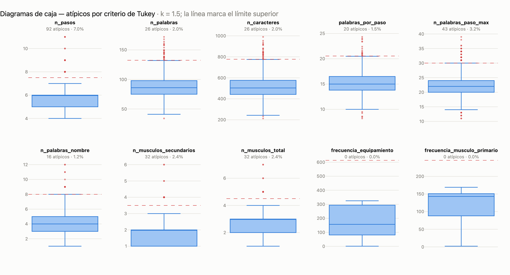

**287 valores atípicos** en 8 de 10 variables. `n_pasos` es la más afectada (92 casos,
6,95 %); `frecuencia_equipamiento` y `frecuencia_musculo_primario` no presentan ninguno.

> **Decisión: no se elimina ningún registro.** Los atípicos son *valores extremos
> legítimos* —ejercicios compuestos y movimientos olímpicos que genuinamente requieren
> más pasos y reclutan más músculos—, no errores de medición. Como no hay nulos ni
> duplicados, el IQR opera aquí como **instrumento de caracterización**, no de limpieza.
> Descartarlos sesgaría el catálogo hacia ejercicios simples, que es justamente el sesgo
> denunciado en §5.1.

### 4.2 Análisis de forma — histogramas con KDE

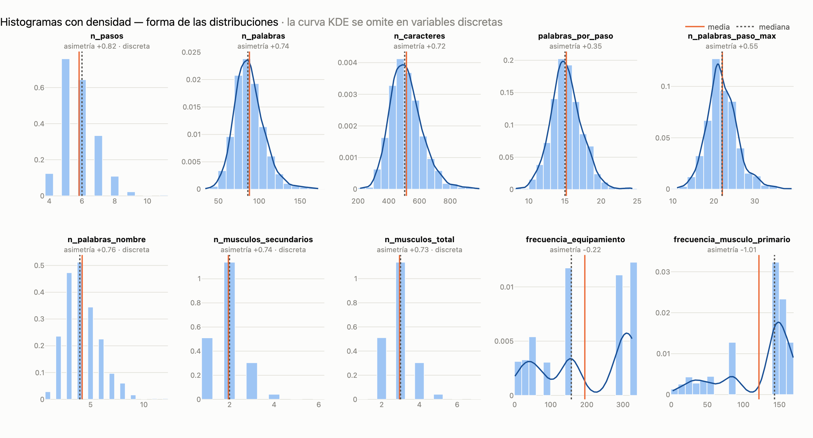

**Sesgo positivo generalizado.** Siete de diez variables presentan asimetría positiva
moderada (+0,55 a +0,83), con media > mediana en todas. El catálogo se compone
mayoritariamente de **ejercicios simples y cortos**, con una cola derecha de movimientos
complejos. La moda de `n_pasos` es 6 y la de `n_musculos_total` es 3.

**La excepción diagnóstica:** `frecuencia_musculo_primario` es la única con **sesgo
negativo fuerte (−1,01)** y curtosis negativa (−0,43). La mayoría de los ejercicios
apuntan a músculos muy cubiertos, con una cola izquierda delgada de músculos casi
huérfanos. Esta asimetría **es la firma estadística del sesgo de muestreo** analizado
en §5.1.

### 4.3 Matriz de correlación de Pearson

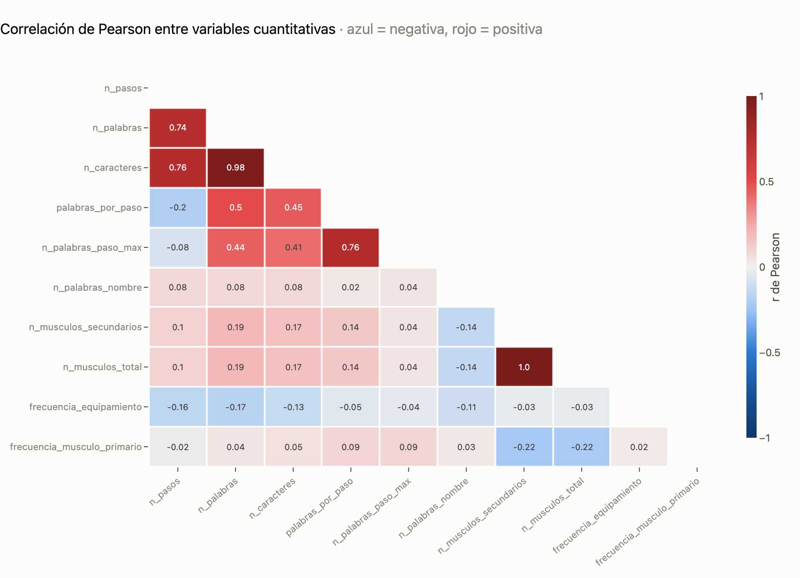

**Redundancia crítica (|r| > 0,9):**

| Par | *r* | Acción |
|---|---|---|
| `n_musculos_secundarios` ↔ `n_musculos_total` | 0,999 | Conservar solo `n_musculos_total` |
| `n_palabras` ↔ `n_caracteres` | 0,981 | Conservar `n_palabras` |

**Hallazgos informativos:**

- `n_pasos` ↔ `palabras_por_paso` = **−0,20**. Correlación negativa: al descomponer un
  ejercicio en más pasos, cada paso se vuelve más breve. El catálogo mantiene
  aproximadamente constante el esfuerzo cognitivo por paso — un patrón de diseño
  editorial, no un accidente.
- `n_musculos_total` ↔ `n_pasos` = **0,10**. La complejidad biomecánica y la textual son
  **ejes independientes**: la extensión de la instrucción no predice la exigencia del
  movimiento. Ambas aportan señal no redundante al futuro modelo.

### 4.4 Auditoría de los recursos cinemáticos

El catálogo tiene dos mitades. Las secciones anteriores analizan los metadatos
tabulares; ésta caracteriza los **1.324 GIF animados**, que son la entrada prevista del
análisis de movimiento. Una arquitectura que depende de ellos no puede validarse
mirando solo el JSON.

**Integridad referencial: sin hallazgos.** El nodo `audit_media_references` verifica
nueve propiedades sin acceder a la red, y las nueve pasan al 100 %: cobertura completa
de `gif_url`, `image` y `media_id`; las tres llaves son únicas (ningún GIF se reutiliza
entre ejercicios); la nomenclatura respeta el patrón `videos/{id}-{media_id}.gif`; y la
atribución está presente en cada registro.

Fue precisamente esta auditoría la que expuso la corrupción del `id` en el cargador
(§3.3): con la llave dañada, solo el 46,8 % de los registros reconstruía su ruta.

**Caracterización física.** Los archivos no están versionados aquí (§5.2), así que
`scripts/auditar_media_fisica.py` descarga una muestra estratificada por parte del
cuerpo, la mide y persiste el resultado en CSV —de modo que el notebook siga siendo
reproducible sin conexión. Sobre 38 animaciones:

| Propiedad | Valor medido | Implicación |
|---|---|---|
| Resolución | **180×180**, sin excepción | Es un **límite contractual**, no técnico (§5.2): no se puede solicitar material mejor |
| Tasa de muestreo | **mediana 4 FPS** (máx. 5,95) | Un fotograma cada 250 ms. Una fase concéntrica rápida (~0,5 s) queda descrita por 2 muestras |
| Fotogramas | mediana 12; 79 % ≤ 12 | Los clips largos (hasta 47) son movimientos compuestos **a la misma tasa baja** |
| Repeticiones por clip | **1** | No existe señal para entrenar un contador de repeticiones |
| Etiquetas temporales | **ninguna** | Sin campos de fase, tempo ni ángulo: cero supervisión |
| Energía de movimiento | 7,4 % de píxeles por fotograma | Hay movimiento real, pero mezclado con el de las estelas |

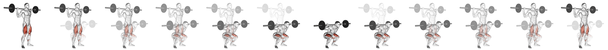

Dos propiedades que ninguna métrica captura y que la evidencia visual muestra de
inmediato: el material son **ilustraciones anatómicas sin piel** —no personas—, con el
músculo objetivo resaltado en rojo; y la animación sugiere la trayectoria superponiendo
la posición inicial como **estela fantasma**, de modo que en la mayoría de los
fotogramas hay dos figuras humanas simultáneas.

> **Consecuencia para la arquitectura de destino.** El componente de *deep learning*
> temporal (componente 2 de §7) **no es entrenable con este corpus**. La limitación no es de volumen
> —que se resolvería con más ejercicios— sino de **naturaleza de la señal**: resolución
> fijada por contrato, muestreo temporal un orden de magnitud por debajo de lo
> necesario, dominio visual equivocado para los estimadores de pose disponibles y
> ausencia total de etiquetas.
>
> Esto **no invalida el producto**: el estimador de pose se aplica sobre la cámara del
> usuario, donde la resolución y la tasa las fija el dispositivo. Lo que queda
> descartado es usar estos GIF como *corpus de entrenamiento*.
>
> Detectarlo **ahora**, en la fase de comprensión de datos, es justamente lo que la
> advertencia del *salto al vacío* busca prevenir: descubrir que los datos no sostienen
> el modelo **después** de haberlo construido.

### 4.5 EDA combinado — catálogo + megaGymDataset + mapeo articular

Parte III del notebook (§14–17). Antes de analizar la unión se auditó la unión misma
(§3.5):

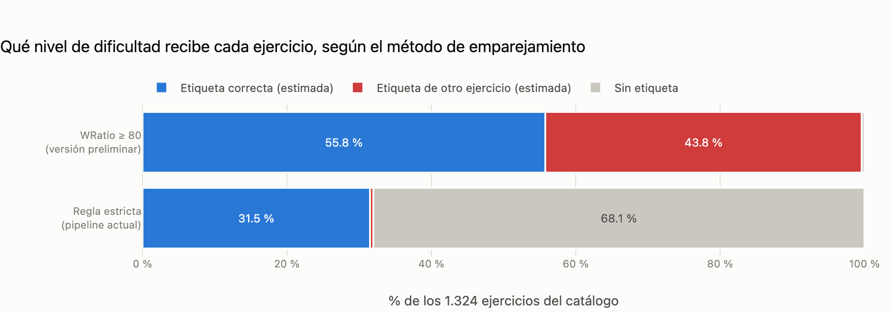

**Dificultad.** Con solo las fichas curadas, **327 ejercicios (24,7 %)** tienen nivel
fiable: **41 % *Beginner*, 58 % *Intermediate* y 2 *Expert*** (`barbell hack squat`,
`scissor jumps`). `Type` casi no varía (*Strength* en el 89 % de los emparejados) y
`Rating` tiene efecto techo (mediana 8,4/10); además mide popularidad, el criterio que
§1.1 descarta para recomendar, así que se conserva solo como descriptor.

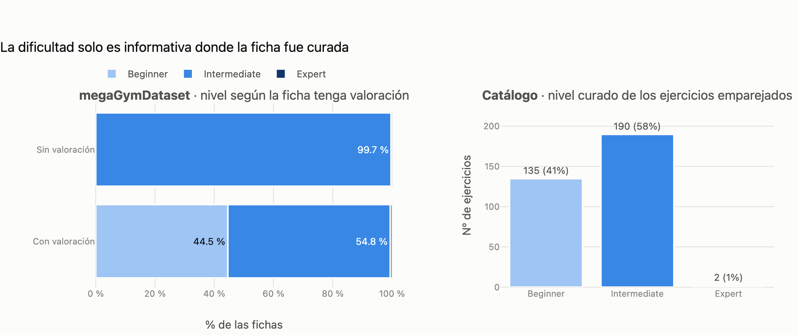

**Dificultad frente a complejidad.** No hay diferencia entre *Beginner* e
*Intermediate* en pasos de instrucción (medianas 6 y 5; Mann-Whitney p = 0,16) ni en
músculos implicados (3 y 3; p = 0,14), con tamaños de efecto despreciables
(|r| < 0,1). La dificultad es un **eje propio**, igual que §4.3 mostró para la
complejidad textual y la biomecánica, y confirma que no era imputable (§3.4).

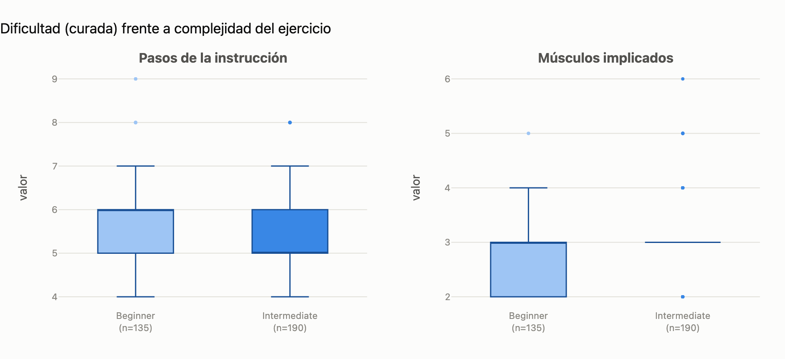

**Articulación × equipamiento.** El tren superior depende del gimnasio: en `codo`
(73 %), `muñeca` / `radiocubital` (79 %), `escapulotorácica` (74 %) y `hombro` (68 %) la
mayoría de los ejercicios exige peso libre o máquina, y el peso corporal no pasa del
17 %. `columna (lumbar)` (46 % peso corporal, 18 % rehabilitación) y `cadera` (40 % y
13 %) concentran las alternativas sin material. Consecuencia directa para la mitigación
de §5.1: la cuota de alternativas sin equipamiento es viable en cadera, columna y
rodilla, pero en codo, muñeca y hombro tendrá pocos candidatos y el sistema recurrirá
más a la abstención.

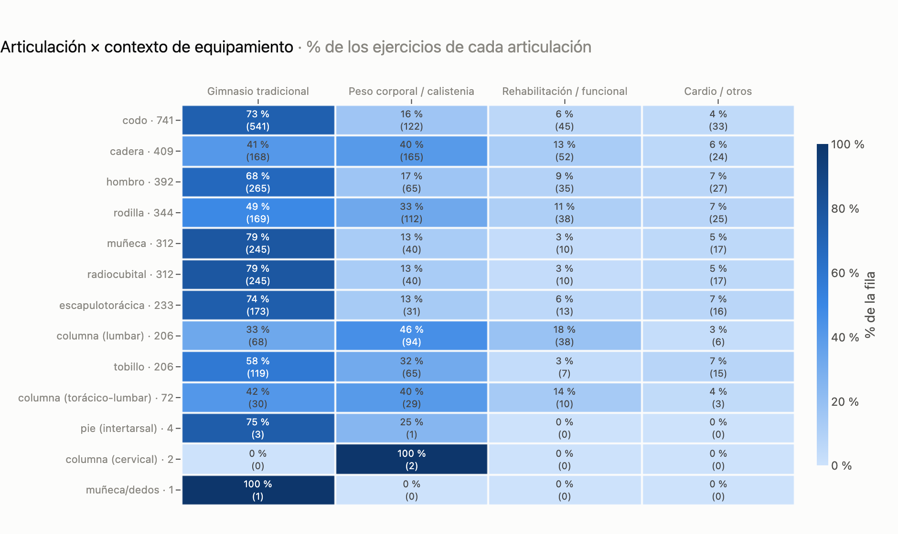

---

## 5. IE4 — Evaluación ética, sesgos y privacidad

### 5.1 Sesgo de muestreo

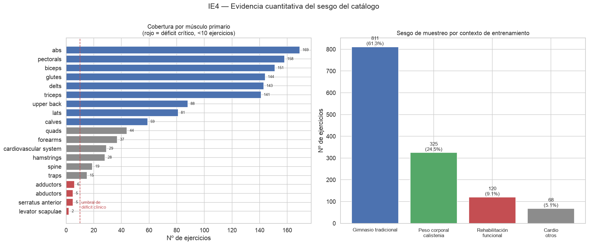

El catálogo **no es una muestra representativa del ejercicio físico**: es un inventario
de gimnasio comercial orientado a hipertrofia. La evidencia es cuantitativa, medida con
el coeficiente de Gini sobre las distribuciones de frecuencia (0 = cobertura uniforme,
1 = concentración total):

| Medición | Valor | Lectura |
|---|---|---|
| Gini de equipamiento | **0,737** | Concentración alta |
| Gini de músculo primario | **0,478** | Concentración moderada |
| Gini por articulación | **0,436** | Concentración moderada: `codo` en el 56 % del catálogo, `muñeca/dedos` en 1 ejercicio (notebook §12.2) |
| Top-3 equipamientos | **58,6 %** del catálogo | *body weight*, *dumbbell*, *cable* |
| Categorías con <10 ejercicios | 13 de 28 | Suman solo 30 ejercicios (2,3 %) |

**Cobertura por contexto de entrenamiento:**

| Contexto | Ejercicios | % |
|---|---|---|
| Gimnasio tradicional (peso libre y máquinas) | 811 | **61,3 %** |
| Peso corporal / calistenia | 325 | 24,5 % |
| Rehabilitación / funcional (bandas, balón, asistido) | 120 | **9,1 %** |
| Cardio / otros | 68 | 5,1 % |

**Cuatro consecuencias éticas concretas:**

1. **Exclusión por acceso material.** El 61,3 % del catálogo exige equipamiento de
   gimnasio. Un usuario sin acceso —por coste, ubicación o movilidad— recibe
   recomendaciones sistemáticamente inaplicables. El sesgo no es neutral: correlaciona
   con nivel socioeconómico.

2. **Déficit de rehabilitación y tercera edad.** Solo el 9,1 % del catálogo emplea
   material funcional o asistido. Las poblaciones que **más se beneficiarían** de una
   guía biomecánica —personas en recuperación post-lesión, adultos mayores— son las peor
   cubiertas.

3. **Músculos huérfanos con relevancia clínica.** Cuatro grupos musculares tienen menos
   de 10 ejercicios: `levator scapulae` (2), `abductors` (5), `serratus anterior` (5) y
   `adductors` (6). Abductores y aductores son centrales en la **estabilidad de cadera**
   y en la prevención de lesiones de rodilla. La funcionalidad de sustitución por lesión
   —el núcleo de la propuesta— tendría hoy un espacio de búsqueda casi vacío para esas
   articulaciones.

4. **Desbalance agonista/antagonista.** `quads` (44 ejercicios) frente a `hamstrings`
   (28), ratio 1,6:1. Un plan generado sin corregir esta proporción **reforzaría** el
   desbalance cuádriceps-isquiotibiales, un factor de riesgo documentado en lesiones de
   ligamento cruzado anterior. El sistema podría aumentar el riesgo que dice mitigar.

**Mitigación adoptada.** El sesgo **no se corrige eliminando filas** —eso reduciría aún
más la cobertura—, sino mediante tres medidas: (a) declararlo explícitamente en este
documento y en la ficha del modelo; (b) imponer en la capa de recomendación una **cuota
mínima de alternativas sin equipamiento**, de modo que el ranking no colapse hacia el
gimnasio; y (c) **rechazar explícitamente** la recomendación cuando el músculo objetivo
esté por debajo del umbral de 10 ejercicios, devolviendo una advertencia de cobertura
insuficiente en lugar de una sugerencia poco fundamentada.

**El enriquecimiento hereda —y agrava— el sesgo.** Unir una fuente externa no es
neutral. megaGymDataset proviene de un sitio de musculación, y eso se nota en quién
recibe una dificultad fiable:

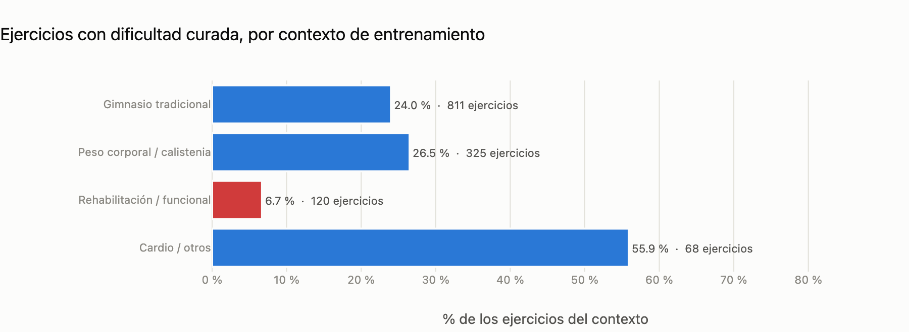

| Contexto | Ejercicios | % con dificultad curada |
|---|---|---|
| Gimnasio tradicional | 811 | 24,0 % |
| Peso corporal / calistenia | 325 | 26,5 % |
| **Rehabilitación / funcional** | 120 | **6,7 %** |
| Cardio / otros | 68 | 55,9 % |

1. **Doble exclusión de la rehabilitación.** Era ya el contexto menos representado del
   catálogo (9,1 %), y es además el que menos dificultad curada recibe. La población
   que más necesitaría una graduación fiable es la que menos la obtiene.
2. **El nivel por defecto es un riesgo de seguridad.** Tomar `Level` sin filtrar habría
   etiquetado como *Intermediate* a casi todo el catálogo (§3.5). Un sistema que gradúa
   progresiones con esa etiqueta ofrecería a un principiante ejercicios "intermedios"
   que nadie clasificó. `nivel_curado` es obligatorio en cualquier uso posterior.
3. **Sin nivel experto no hay progresión avanzada** (2 ejercicios). El sistema no debe
   prometer planes para usuarios avanzados sobre esta base.

### 5.2 Propiedad intelectual — licenciamiento dual

El repositorio de origen **no tiene una sola licencia**: separa explícitamente los datos
de los medios, y cada mitad se rige por un régimen distinto. La distinción es central
para este proyecto, porque determina qué se puede publicar y qué no.

| Componente | Régimen | Alcance |
|---|---|---|
| **Datos tabulares** (nombres, categorías, partes del cuerpo, equipamiento, músculos, instrucciones multilingües) | **Licencia MIT** — © 2026 Hasan Emir Yıldırım | Uso, modificación, distribución y sublicenciamiento libres, conservando el aviso de copyright |
| **Medios** (GIF animados e imágenes) | **Propiedad de Gym visual**, redistribuidos con permiso escrito separado | Sujeto a los *Terms & Conditions* de Gym visual y a las condiciones de redistribución del `NOTICE.md` |

**Sobre los datos (lo que usa esta entrega).** Todo el trabajo de EV1 —el pipeline, el
EDA, las tablas derivadas— opera **exclusivamente sobre la mitad MIT** del dataset. No
hay restricción legal alguna sobre lo entregado aquí.

**Sobre los medios.** El `NOTICE.md` del repositorio de origen establece condiciones
explícitas que conviene citar textualmente, porque son más estrictas de lo que sugiere
el campo `attribution`:

- Los medios se redistribuyen con el **permiso escrito separado** del titular —el
  mecanismo que los propios términos de Gym visual exigen para redistribuir—, no bajo
  una licencia abierta ni bajo doctrina de *fair use*.
- **Límite de resolución contractual: 180×180 únicamente.** No es una limitación
  técnica que se pueda resolver pidiendo archivos mejores: es una condición del permiso.
- **Atribución obligatoria** en todo uso: `© Gym visual — https://gymvisual.com/`.
- Y de forma expresa: *"este repositorio no te otorga ningún derecho sobre los medios
  más allá de lo que permiten los términos de Gym visual — clonar este repositorio no
  es una licencia."*

**Consecuencias prácticas para el proyecto:**

1. **Bifurcar el forkeo no otorga derechos.** El equipo, por haber forkeado el
   repositorio, **no adquirió licencia sobre los GIF**. Cualquier uso que exceda los
   términos de Gym visual requiere una licencia propia obtenida directamente del titular.
2. **El uso como dato de entrenamiento es un uso derivado distinto del de exhibición.**
   El permiso documentado cubre la *redistribución* de los medios. Entrenar un modelo
   sobre ellos —extraer coordenadas articulares para ajustar parámetros— es una
   utilización derivada que los términos citados no autorizan de forma explícita. Antes
   de cualquier entrenamiento sobre este material hay que resolver esa pregunta con el
   titular, no asumirla.
3. **Atribución preservada por diseño.** El campo `attribution` se conserva íntegro en
   todas las capas del pipeline; no se elimina ni se ofusca en ningún punto de la
   transformación.
4. **Desacople estructural entre datos y renderizados.** La arquitectura separa la capa
   de datos (MIT, redistribuible) de la capa de medios (restringida), de modo que una
   versión distribuible del sistema pueda operar con animaciones propias o de licencia
   distinta sin tocar el resto del pipeline.

> **Corrección respecto de la formulación inicial del proyecto.** El encuadre original
> invocaba la doctrina de *uso académico / fair use*. Tras revisar el `NOTICE.md` y el
> `LICENSE` de la fuente, ese encuadre era **incorrecto y además innecesariamente
> débil**: los datos están bajo MIT (un permiso explícito, no una defensa), y los medios
> se rigen por un permiso escrito con condiciones tasadas. El *fair use* es un argumento
> defensivo que se invoca cuando no hay licencia; aquí sí la hay, y conviene apoyarse en
> ella. Lo que el *fair use* tampoco habilitaría —publicar los medios o desplegarlos
> comercialmente— sigue igualmente vedado.

**Las fuentes externas.**

- **megaGymDataset** se publica en Kaggle bajo **CC0** (dominio público), verificado en
  la ficha del dataset. Pero la propia ficha declara que los datos fueron *extraídos de
  diversas fuentes de internet*: quien lo sube puede renunciar a sus derechos, no a los
  de terceros. Por eso el pipeline usa solo atributos fácticos (`Level`, `Type`,
  `Rating`) y **descarta `Desc`**, que es texto redactado por terceros; ninguna salida
  del proyecto la redistribuye.
- **Mapeo músculo → articulación.** Las filas de Wikipedia se basan en contenido
  CC BY-SA y citan su fuente; las de ExRx.net se obtuvieron por consulta manual y citada,
  sin copiar texto ni automatizar la extracción (su `robots.txt` lo prohíbe; ver el
  docstring de `scripts/construir_mapeo_articulaciones.py`).

### 5.3 Responsabilidad algorítmica y seguridad

> **⚕️ Exención de responsabilidad médica.** Este sistema es una herramienta informativa
> y educativa. **No constituye diagnóstico, prescripción ni tratamiento médico**, y no
> sustituye la evaluación de un profesional de la salud —médico, kinesiólogo o
> fisioterapeuta—. Las recomendaciones se derivan de un catálogo de ejercicios de
> propósito general, sin conocimiento del historial clínico, las patologías previas ni
> las contraindicaciones del usuario. Ante dolor, lesión activa o condición médica
> diagnosticada, consulte a un profesional antes de iniciar cualquier rutina.

**Reglas de seguridad de diseño:**

| Regla | Implementación |
|---|---|
| No prescribir sobre articulación comprometida | Enmascarado obligatorio de la articulación declarada; el ejercicio se excluye del espacio de búsqueda, no se pondera a la baja |
| Abstención ante cobertura insuficiente | Si el músculo objetivo tiene <10 ejercicios, se devuelve advertencia explícita en lugar de recomendación |
| No inferir capacidad clínica | El catálogo carece de contraindicaciones y solo el 24,7 % tiene dificultad curada (§3.5); el sistema **no estima** las variables ausentes ni usa el nivel por defecto de megaGymDataset |
| Trazabilidad de la recomendación | Toda sugerencia expone su justificación (músculo objetivo preservado, articulación excluida), de modo que sea auditable por el usuario o su terapeuta |
| Sin retroalimentación correctiva en tiempo real | El análisis de postura reporta desviaciones angulares como *observación*, nunca como corrección imperativa que el usuario deba ejecutar bajo carga |

**Limitación asumida:** el sistema puede fallar por omisión —no recomendar algo útil— o
por cobertura —no encontrar sustituto—. Se diseña para que **falle hacia la abstención**,
no hacia la sugerencia infundada. En un dominio donde el error se paga con una lesión,
el silencio es preferible a la confianza injustificada.

### 5.4 Privacidad radical mediante Edge AI

El componente de análisis de movimiento procesa **vídeo de la cámara del usuario**: el
dato más sensible de todo el sistema. La decisión arquitectónica es procesarlo
**íntegramente en el dispositivo**.

**Arquitectura:** conversión de los modelos a formato Core ML con cuantización FP16/INT8,
e inferencia local sobre el Apple Neural Engine mediante el framework Vision. El vídeo
**nunca abandona el teléfono**: no se transmite, no se almacena en servidores, no se
usa para reentrenar. Lo que persiste localmente son métricas agregadas —ángulos
articulares, conteo de repeticiones—, no fotogramas.

**Cumplimiento normativo:**

- **Ley N° 19.628 (Chile), sobre protección de la vida privada.** Marco vigente para el
  tratamiento de datos personales. Al no existir transmisión ni almacenamiento remoto,
  no hay banco de datos personales bajo control del responsable: el riesgo se elimina
  en origen, no se gestiona con controles de acceso.
- **Ley N° 21.719 (Chile).** Nueva normativa de protección de datos personales que
  sustituye el marco anterior, crea la Agencia de Protección de Datos Personales y
  clasifica los **datos biométricos como datos sensibles**, sujetos a consentimiento
  expreso y a un régimen sancionatorio reforzado. El diseño *on-device* anticipa este
  estándar. *(Verificar la fecha exacta de entrada en vigencia al momento de la defensa.)*
- **RGPD (UE).** Bajo el Art. 4(14), la calificación como *dato biométrico* exige que el
  tratamiento persiga la **identificación unívoca** de la persona. La estimación de
  pose para evaluar técnica deportiva **no persigue identificar** al usuario, por lo que
  no activa por sí sola el régimen del Art. 9. No obstante, el vídeo de una persona
  identificable **sí es dato personal**, y el proyecto adopta el estándar más exigente
  por precaución.
- **Principios aplicados:** *privacy by design* y *privacy by default* (Art. 25 RGPD) —
  la configuración más protectora es la única disponible, no una opción a activar— y
  **minimización de datos** (Art. 5.1.c): solo se derivan las coordenadas articulares
  necesarias, descartando el fotograma inmediatamente después de procesarlo.

**Beneficio colateral:** el procesamiento local elimina el consumo de datos móviles y
la latencia de red, habilitando análisis a 30+ FPS sin conectividad. La decisión ética
y la técnica coinciden.

---

## 6. Limitaciones reconocidas

1. **Variables de estratificación — dificultad solo parcial.** *(EV2: mecánica y fuerza
   cubren ahora el 85,5 % y 95,5 % del catálogo, y la dificultad se reemplazó por la
   complejidad técnica, §12.)* El catálogo carece de
   mecánica (compuesto/aislado), tipo de fuerza (empuje/tracción) y contraindicaciones.
   La dificultad llega desde megaGymDataset solo para el **24,7 %** de los ejercicios
   (nivel curado, §3.5), con 2 casos *Expert* y un sesgo contra la rehabilitación
   (§5.1). Alcanza para describir el catálogo, no para auditar el sesgo por nivel del
   usuario en todo él.
2. **Articulaciones no modeladas explícitamente — parcialmente resuelto.** El
   catálogo describe músculos, no articulaciones. `scripts/construir_mapeo_articulaciones.py`
   construye `data/01_raw/musculo_articulacion_manual.csv`: de los 50 valores únicos
   de músculo del catálogo (`target` + `secondary_muscles`), **40 tienen articulación
   confirmada** con fuente citada por fila —la ficha anatómica de Wikipedia
   (`Infobox muscle` vía API, más una fila desde su tabla de movimientos por
   articulación; 35 filas) y, donde esa fuente no alcanzaba, consulta directa a
   ExRx.net (5 filas)—. En las filas de Wikipedia, la ficha se contrastó además con un
   borrador de anatomía estándar antes de aceptarla. Sigue **sin validación clínica
   profesional** (ver punto 4), que es el prerrequisito real para producción, no solo
   para el prototipo del grafo.

   > **Decisión pendiente de arquitectura.** *(Resuelta en la EV2: nodo de región con
   > articulación solo por consenso, §11.2. El *fan-out* se probó en el grafo y se
   > descartó, §13.4.)* Cuatro etiquetas del catálogo son regiones
   > compuestas, no un músculo con una sola articulación: `back`, `chest`, `shoulders`,
   > `core` (p. ej. `back` es la unión de dorsal ancho, trapecio, romboides, rotador y
   > erector espinal —cada uno ya confirmado por separado en la tabla—). Falta decidir
   > qué hace el nodo que construya las aristas del grafo cuando un ejercicio trae una
   > de estas etiquetas en vez de un músculo específico:
   >
   > | Opción | Consecuencia |
   > |---|---|
   > | **Excluir la arista** | Ese registro no aporta arista músculo→articulación. Pierde cobertura, no inventa precisión que el dato no tiene. |
   > | **Fan-out a los sub-músculos** | Se generan aristas hacia los ~4-5 músculos de la descomposición. Gana cobertura, pero asume que el ejercicio trabajó *todos* esos músculos por igual, lo cual no está en la fuente. |
   >
   > Se favorece **excluir** por el mismo criterio que ya rige los outliers de §4.1: no
   > eliminar datos por comodidad, pero tampoco fabricar una relación que el catálogo no
   > afirma. Otras seis etiquetas (`ankles`, `cardiovascular system`, `feet`, `hands`,
   > `spine`, `wrists`) no son músculos en absoluto —son la articulación misma o un
   > sistema no muscular— y se excluyen del mapeo sin ambigüedad, no quedan como decisión
   > abierta.
3. **Los recursos cinemáticos no sirven como corpus de entrenamiento.** Medidos en
   §4.4: 180×180 px por límite contractual, mediana de 4 FPS, una repetición por clip,
   ilustraciones anatómicas en lugar de personas y sin etiqueta temporal alguna. No es
   una limitación de acceso —los archivos son obtenibles— sino de contenido.
4. **Sin validación clínica.** Ninguna de las asignaciones musculares del catálogo, ni
   del mapeo músculo → articulación del punto 2, ha sido verificada por un profesional
   del área. Se asume la fuente como correcta.
5. **Sesgo lingüístico.** Se conserva únicamente el español; el análisis textual no es
   extrapolable a los otros nueve idiomas.
6. **Emparejamiento por nombre.** La unión con megaGymDataset no tiene llave: su
   precisión (96 % en los pares difusos) se estima sobre una muestra de 50 pares, no
   sobre todos, y la regla estricta renuncia a variantes que probablemente sí son el
   mismo ejercicio (cobertura 31,9 %). Una regla de *contención* (el título de
   megaGymDataset contenido en el nombre, con coherencia de región y equipamiento)
   podría recuperar parte de ellas; queda como mejora, validada con una muestra nueva
   antes de adoptarla.

**Limitaciones de los modelos (EV2):**

7. **Etiquetas de una sola fuente.** Mecánica, fuerza y complejidad se aprenden de
   free-exercise-db: el modelo reproduce el criterio de ese curador, que tampoco está
   validado clínicamente (§12.5).
8. **Familias según la anotación.** Las familias de movimiento reflejan cómo están
   anotados los ejercicios (músculos, fuerza, equipamiento), no una medición del
   movimiento. La *silhouette* moderada (0,23) indica fronteras difusas (§13.6).
9. **Sesgo por abstención.** El modelo se abstiene más en wger, así que sus ejercicios
   casi no llegan al perfil de principiante (§14.3).
10. **Recomendaciones evaluadas con reglas.** El KPI de sustitución mide que las
    alternativas sean seguras y de la misma familia, no que un entrenador las considere
    buenas. La revisión manual de 30 casos (§13.5) da 20 que sirven, 8 malos y 2
    inseguros (ya corregidos): con 30 casos es una señal, no una certificación.
11. **La seguridad depende de que la anotación esté completa.** Una primera lectura de esa
    muestra encontró alternativas que cargaban la lumbar sin que su ficha lo anotara
    (*Kettlebell deadlifts* para un peso muerto rumano). La carga por patrón de movimiento
    (§13.2) cierra los casos que el nombre delata, pero un ejercicio con ficha incompleta y
    nombre poco descriptivo todavía puede pasar. Lo cierra la validación clínica del mapeo
    y de las fichas más recomendadas (§10, punto 1).

---

## 7. Arquitectura de destino (estado tras la EV2)

Norte técnico del proyecto. El punto 1 se implementó en la EV2 en su versión base; los
puntos 2 y 3 siguen fuera de alcance:

1. **Grafo de conocimiento biomecánico** — ✅ **implementado en la EV2 (§13)**: nodos
   Ejercicio, Músculo, Articulación, Equipamiento y etiquetas de la fase 2; *embeddings*
   Node2Vec y sustitución enmascarando la articulación vetada. Queda pendiente la
   validación clínica del mapeo músculo → articulación (§10, punto 1). Una GCN no hizo
   falta: Node2Vec + K-Means cumplió el KPI.
2. **Análisis temporal de movimiento** — ⚠️ **replanteado tras la auditoría de §4.4.**
   La formulación original entrenaba un modelo secuencial sobre coordenadas extraídas de
   los GIF; ese corpus no lo permite. La vía viable extrae la pose de la **cámara del
   usuario**, donde el dispositivo fija resolución y tasa. Nótese además que MediaPipe
   entrega 33 puntos y Apple Vision 19 (2D) o 17 (3D): no son topologías
   intercambiables, y hay que comprometerse con una.
3. **Despliegue Edge AI** — cuantización a Core ML e inferencia en el Apple Neural
   Engine (§5.4).

---

## 8. Reproducibilidad

### 8.1 Instalación

```bash
python3.13 -m venv .venv          # o: uv venv --python 3.13 .venv
source .venv/bin/activate
pip install -r requirements-lock.txt   # versiones exactas con que se generaron los resultados
```

`requirements.txt` declara las versiones mínimas; `requirements-lock.txt`, el entorno
exacto. Para reproducir las cifras de este informe conviene el segundo.

Requiere **Python 3.13** (`.python-version`): `gensim`, usado por Node2Vec en el grafo
biomecánico (§13), no compila todavía en Python 3.14.

### 8.2 Ejecución del pipeline

```bash
kedro run                              # pipeline completo (30 nodos, ~3 min)
kedro run --pipeline=data_understanding   # 9 nodos: auditoría, features y EDA diagnóstico
kedro run --pipeline=data_enrichment      # 3 nodos: megaGymDataset (requiere el anterior)
kedro run --pipeline=integracion_fuentes  # 8 nodos: free-exercise-db + wger (EV2, §11; requiere los dos anteriores)
kedro run --pipeline=modelado_supervisado # 4 nodos: modelos del perfil de exigencia y su diagnóstico (EV2, §12; requiere el anterior)
kedro run --pipeline=grafo_biomecanico    # 6 nodos: grafo, Louvain, Node2Vec + K-Means, sustitución (EV2, §13; ~1 min)
```

Las instantáneas de free-exercise-db y wger ya están versionadas en `data/01_raw/`.
Para refrescarlas (requiere red; cambia los resultados, ver el manifiesto):

```bash
python scripts/descargar_fuentes_externas.py
```

**Reproducibilidad verificada.** Dos ejecuciones completas de `kedro run` dan salidas con
el mismo contenido que las versionadas: semillas fijas en `parameters.yml` y un solo hilo
en word2vec. Los datos crudos son inmutables, y su huella SHA-256 queda registrada en
`data/01_raw/huellas_sha256.txt`:

```bash
python scripts/registrar_huellas.py --verificar   # falla si algún archivo crudo cambió
```

### 8.3 Notebooks

```bash
jupyter lab notebooks/01_exploratory_data_analysis.ipynb   # EDA (EV1)
jupyter lab notebooks/02_modelado_supervisado.ipynb        # Modelado supervisado (EV2, §12)
jupyter lab notebooks/03_modelado_no_supervisado.ipynb     # Grafo biomecánico no supervisado (EV2, §13)
```

El notebook está versionado **con todas las salidas ejecutadas y visibles**. Se ejecuta
de principio a fin sin errores en orden secuencial (67 celdas, en tres partes:
composición del catálogo, diagnóstico IE3/IE4 y EDA combinado de las tres fuentes).

Los quince gráficos son **interactivos** (Plotly): cada marca expone su valor al pasar el
cursor, y las tablas de datos que los acompañan permiten leer las mismas cifras sin
depender del color. El renderizador `notebook` embebe `plotly.js` dentro del `.ipynb`,
de modo que los gráficos se ven **sin conexión a internet** en Jupyter, JupyterLab,
VS Code y nbviewer.

> **Nota:** la previsualización de `.ipynb` en la web de GitHub no ejecuta JavaScript y
> por tanto **no muestra los gráficos interactivos**. Para revisarlos hay que abrir el
> notebook en Jupyter o VS Code. Las versiones estáticas en PNG están en
> `data/08_reporting/figures/` y son las que se incrustan en este README.

### 8.4 Tests

```bash
python -m pytest -q      # 52 tests, ~6 s; corren sobre los artefactos versionados
```

| Nivel | Qué verifica |
|---|---|
| Unitarios | Emparejamiento (veto de `abduction`/`adduction`, modificadores opuestos), reglas del perfil, regla de un error estándar, umbral de abstención, contraste pareado |
| Datos | 2.592 ejercicios únicos, `id` con ceros a la izquierda (el defecto de §3.3), esquema y dominios de las etiquetas, partición sin grupos compartidos, datos crudos sin cambios |
| Modelo | F1 al menos 0,2 sobre el azar y KPI de F1 ≥ 0,85; invariancia (cambiar barra por mancuernas casi no cambia la mecánica); dirección (más articulaciones, más probabilidad de compuesto) |
| Sustituidor | Ninguna alternativa carga la articulación vetada; abstención sin sustituto anatómico; demostración sentadilla → Hip Thrust |
| Dashboard | Las seis vistas se dibujan sin errores; la tabla de niveles marca las 102 coincidencias; la demo propone el Hip Thrust y se abstiene con la extensión de piernas (§8.7) |
| MLflow | Las métricas registradas son las de los reportes versionados; el hook deja la corrida terminada y el modelo del registro predice igual que el `.pkl` (§8.8) |

GitHub Actions corre los tests en cada *push* (`.github/workflows/tests.yml`).

### 8.5 Estructura del repositorio

```
proyecto_ejercicios/
├── conf/
│   ├── base/
│   │   ├── catalog.yml              # Definición declarativa de los datasets
│   │   ├── mlflow.yml               # Seguimiento de experimentos (§8.8)
│   │   └── parameters.yml
│   └── databricks/
│       └── catalog.yml              # Mismo pipeline sobre tablas Delta (§2.3)
├── data/
│   ├── 01_raw/
│   │   ├── exercises.json               # Fuente 1, inmutable (17 MB)
│   │   ├── megaGymDataset.csv           # Fuente 2, Kaggle CC0 (§2.1)
│   │   ├── musculo_articulacion_manual.csv   # Fuente 3: curación músculo → articulación (§6.2)
│   │   ├── movimientos_articulares_wikipedia.csv  # Taxonomía de movimientos por articulación
│   │   ├── megagym_match_validacion_manual.csv    # Muestras revisadas del emparejamiento (§3.5)
│   │   ├── free_exercise_db.json        # Fuente 4, The Unlicense (§11)
│   │   ├── wger_exercises.json          # Fuente 5, CC-BY-SA por ejercicio (§11)
│   │   ├── fuentes_externas_manifest.json   # Commit y fecha de las dos instantáneas
│   │   ├── articulaciones_canonicas.csv     # Ontología: músculo → articulación(es)
│   │   ├── regiones_compuestas.csv          # Ontología: región → músculos componentes
│   │   ├── vocabulario_muscular_externo.csv # Ontología: músculos de fuentes 4 y 5 → canónicos
│   │   ├── equipamiento_canonico.csv        # Ontología: equipamiento → familia y contexto
│   │   ├── fuentes_match_validacion_manual.csv  # Muestras revisadas del emparejamiento (§11)
│   │   └── huellas_sha256.txt           # Huella de cada archivo crudo (§8.2)
│   ├── 02_intermediate/
│   │   ├── exercises_clean.parquet  # Grano ejercicio × músculo secundario
│   │   ├── exercise_features.parquet# Grano ejercicio (tabla analítica)
│   │   ├── megagym.parquet          # megaGymDataset limpio y deduplicado
│   │   ├── catalogo_unificado.parquet   # Catálogo en el esquema común (§11)
│   │   ├── free_exercise_db.parquet     # free-exercise-db en el esquema común
│   │   ├── wger.parquet                 # wger en el esquema común, deduplicado
│   │   └── vocabulario_muscular.csv     # (fuente, músculo de origen) → músculo canónico
│   ├── 05_model_input/
│   │   ├── tabla_modelado.parquet       # Variables comunes a las tres fuentes, partición y grupos (§12)
│   │   └── grafo_nodos_ejercicio.parquet  # Ejercicios del grafo: perfil, músculos y articulaciones que carga (§13)
│   ├── 07_model_output/
│   │   ├── perfil_exigencia.parquet     # Mecánica, fuerza, complejidad y reglas por nodo, con origen y confianza
│   │   └── familias_movimiento.parquet  # Familia (Louvain y K-Means) y coordenadas UMAP por ejercicio (§13)
│   ├── 03_primary/
│   │   ├── exercise_features_enriched.parquet  # Tabla analítica + nivel, tipo, rating
│   │   ├── ejercicios.parquet           # Nodos Ejercicio del grafo: 2.592 únicos, con etiquetas (§11)
│   │   ├── ejercicio_musculo.parquet    # Aristas Ejercicio → Músculo (agonista / sinergista)
│   │   └── musculo_articulacion.csv     # Aristas Músculo → Articulación (directas y por consenso)
│   └── 08_reporting/
│       ├── eda_summary.csv
│       ├── distribution_metrics.csv
│       ├── outliers_iqr.csv
│       ├── shape_statistics.csv
│       ├── correlation_matrix.csv
│       ├── media_references_audit.csv   # Integridad referencial de los medios
│       ├── media_sample_audit.csv       # Caracterización física (muestra)
│       ├── cobertura_articulaciones.csv # Ejercicios por articulación (notebook §12.2)
│       ├── megagym_match_audit.csv      # Decisión de emparejamiento por ejercicio
│       ├── match_free_exercise_db.csv   # Emparejamiento free-exercise-db → catálogo (§11)
│       ├── match_wger.csv               # Emparejamiento wger → catálogo + free-exercise-db
│       ├── integracion_fuentes_resumen.csv  # Cobertura de etiquetas por fuente y contexto
│       ├── modelos_comparacion.csv      # F1, accuracy y parámetros por objetivo × modelo × conjunto (§12)
│       ├── modelos_predicciones_test.csv    # Predicciones y probabilidades en test y validación externa
│       ├── modelos_cv_repetida.csv      # Diagnóstico (§12.6): F1 por pliegue, CV repetida 5 × 5
│       ├── modelos_contraste_pareado.csv    # Logística vs. Random Forest, prueba de Nadeau-Bengio
│       ├── modelos_calibracion.csv      # Brier sin calibrar, sigmoide e isotónica
│       ├── modelos_curva_aprendizaje.csv    # F1 en validación según el tamaño de train
│       ├── modelos_control_fuga.csv     # Prueba del objetivo barajado
│       ├── modelos_importancia.csv      # Importancia por permutación en validación
│       ├── validacion_adversarial.csv   # ¿Se distingue free-exercise-db del catálogo y de wger?
│       ├── louvain_barrido.csv          # Modularidad y estabilidad por resolución (§13)
│       ├── kmeans_barrido.csv           # Codo, silhouette, Davies-Bouldin y estabilidad por k
│       ├── clustering_comparacion.csv   # Louvain vs. Node2Vec + K-Means
│       ├── familias_perfiles.csv        # Perfil de cada familia de movimiento
│       ├── sustitucion_cobertura.csv    # KPI de sustitución por articulación y método
│       ├── sustitucion_contexto.csv     # KPI de sustitución por contexto
│       └── figures/                 # Exportación PNG de los gráficos
├── scripts/
│   ├── auditar_media_fisica.py      # Auditoría de GIF (requiere red)
│   ├── descargar_fuentes_externas.py    # Instantáneas de free-exercise-db y wger (requiere red)
│   ├── registrar_huellas.py         # Registra o verifica la huella de los datos crudos
│   └── construir_mapeo_articulaciones.py  # Tabla músculo → articulación (§6.2)
├── notebooks/
│   ├── 01_exploratory_data_analysis.ipynb
│   ├── 02_modelado_supervisado.ipynb    # EV2: modelos, interpretación y abstención (§12)
│   ├── 03_modelado_no_supervisado.ipynb # EV2: grafo, familias de movimiento y sustitución (§13)
│   └── databricks/                  # Notebooks de la migración a Delta (§2.3)
│       ├── 01_bronze_ingesta_delta.py
│       └── 02_silver_gold_medallion.py
├── docs/
│   ├── databricks_setup.md          # Puesta en marcha del workspace
│   ├── plan_ev2.md                  # Plan de trabajo de la EV2
│   ├── registro_decisiones.md       # Qué se probó, qué se descartó y por qué
│   └── ficha_modelo.md              # Uso previsto, métricas por subgrupo y limitaciones
├── app/dashboard.py                 # Dashboard de la presentación, Streamlit (§8.7)
├── tests/                           # Tests unitarios, de datos, de modelo y del dashboard (§8.4)
├── .github/workflows/tests.yml      # CI: pytest en cada push
├── src/gym_exercises/
│   ├── hooks.py                     # Registro de cada corrida en MLflow (§8.8)
│   ├── pipeline_registry.py
│   └── pipelines/
│       ├── data_understanding/
│       │   ├── nodes.py             # 9 nodos puros y testeables
│       │   └── pipeline.py          # Definición del DAG
│       ├── data_enrichment/
│       │   ├── nodes.py             # 3 nodos: limpieza, emparejamiento auditado, unión
│       │   └── pipeline.py
│       ├── integracion_fuentes/
│       │   ├── nodes.py             # 8 nodos: ontología, esquema común, emparejamiento, consolidación
│       │   └── pipeline.py
│       ├── modelado_supervisado/
│       │   ├── nodes.py             # 4 nodos: tabla de modelado, entrenamiento y comparación, diagnóstico, predicción
│       │   └── pipeline.py
│       └── grafo_biomecanico/
│           ├── nodes.py             # 6 nodos: grafo, Louvain, Node2Vec, K-Means, familias, sustitución
│           └── pipeline.py
├── models/
│   ├── modelos_supervisados.pkl     # Modelos ganadores por objetivo, con su umbral de abstención
│   ├── grafo_biomecanico.pkl        # Grafo heterogéneo (networkx) (§13)
│   └── embeddings_node2vec.parquet  # Vector de 16 dimensiones por nodo del grafo
├── requirements.txt                 # Versiones mínimas
├── requirements-lock.txt            # Versiones exactas (Python 3.13)
└── README.md
```

**Estructura exigida por la pauta.** La pauta pide `data/`, `notebooks/`, `models/`,
`images/` y `README.md`. Los cuatro primeros existen con ese nombre. Las imágenes viven
en `data/08_reporting/figures/`, la convención de Kedro para las salidas de reporte: así
cada `kedro run` y cada notebook regeneran las figuras en el mismo lugar que el resto de
los reportes, y el README las incrusta desde ahí.

### 8.6 Nodos del pipeline

| Nodo | Entrada | Salida |
|---|---|---|
| `audit_dataset_structure` | `raw_exercises_data` | `audit_report` (memoria) |
| `flatten_exercise_metadata` | `raw_exercises_data` | `intermediate_exercises_clean` |
| `compute_distribution_metrics` | `intermediate_exercises_clean` | `distribution_metrics` |
| `save_eda_summary` | `audit_report`, `distribution_metrics` | `eda_summary_report` |
| `build_exercise_features` | `raw_exercises_data` | `intermediate_exercise_features` |
| `detect_outliers_iqr` | `intermediate_exercise_features` | `outliers_iqr_report` |
| `compute_shape_statistics` | `intermediate_exercise_features` | `shape_statistics_report` |
| `compute_correlation_matrix` | `intermediate_exercise_features` | `correlation_matrix_report` |
| `audit_media_references` | `raw_exercises_data` | `media_references_report` |
| `preparar_megagym` | `raw_megagym_data` | `intermediate_megagym` |
| `emparejar_con_megagym` | `intermediate_exercise_features`, `intermediate_megagym`, `params:emparejamiento_megagym` | `megagym_match_report` |
| `enrich_with_external_metadata` | `intermediate_exercise_features`, `intermediate_megagym`, `megagym_match_report` | `primary_exercise_features_enriched` |
| `construir_ontologia_muscular` | `musculo_articulacion_manual`, `vocabulario_muscular_externo`, `articulaciones_canonicas`, `regiones_compuestas` | `vocabulario_muscular`, `primary_musculo_articulacion` |
| `preparar_catalogo` | `raw_exercises_data`, `primary_exercise_features_enriched`, `vocabulario_muscular`, `equipamiento_canonico` | `intermediate_catalogo_unificado` |
| `preparar_free_exercise_db` | `raw_free_exercise_db`, `vocabulario_muscular`, `equipamiento_canonico` | `intermediate_free_exercise_db` |
| `preparar_wger` | `raw_wger`, `vocabulario_muscular`, `equipamiento_canonico` | `intermediate_wger` |
| `emparejar_free_exercise_db` | esquemas comunes, ontología, `params:emparejamiento_fuentes` | `match_free_exercise_db_report` |
| `emparejar_wger` | esquemas comunes, ontología, `params:emparejamiento_fuentes` | `match_wger_report` |
| `consolidar_ejercicios` | esquemas comunes, reportes de emparejamiento | `primary_ejercicios`, `primary_ejercicio_musculo` |
| `resumir_integracion` | `primary_ejercicios`, `primary_ejercicio_musculo`, `primary_musculo_articulacion` | `integracion_fuentes_resumen` |
| `construir_tabla_modelado` | `intermediate_free_exercise_db`, `primary_ejercicios`, `match_free_exercise_db_report`, `primary_musculo_articulacion`, `params:modelado_supervisado` | `model_input_tabla_modelado` |
| `entrenar_modelos` | `model_input_tabla_modelado`, `params:modelado_supervisado` | `modelos_comparacion`, `modelos_predicciones_test`, `modelos_supervisados` |
| `diagnosticar_modelos` | `model_input_tabla_modelado`, `modelos_supervisados`, `params:modelado_supervisado` | `modelos_cv_repetida`, `modelos_contraste_pareado`, `modelos_calibracion`, `modelos_curva_aprendizaje`, `modelos_control_fuga`, `modelos_importancia`, `validacion_adversarial` |
| `predecir_etiquetas` | `model_input_tabla_modelado`, `primary_ejercicios`, `modelos_supervisados` | `model_output_perfil_exigencia` |
| `construir_grafo` | `primary_ejercicios`, `model_output_perfil_exigencia`, `primary_ejercicio_musculo`, `primary_musculo_articulacion`, `regiones_compuestas`, `params:grafo_biomecanico` | `grafo_biomecanico`, `grafo_nodos_ejercicio` |
| `detectar_comunidades` | `grafo_biomecanico`, `grafo_nodos_ejercicio` | `comunidades_louvain` (memoria), `louvain_barrido` |
| `entrenar_node2vec` | `grafo_biomecanico` | `embeddings_node2vec` |
| `agrupar_embeddings` | `embeddings_node2vec`, `grafo_nodos_ejercicio` | `clusters_kmeans` (memoria), `kmeans_barrido` |
| `consolidar_familias` | nodos, comunidades, clusters, embeddings, grafo | `model_output_familias_movimiento`, `familias_perfiles`, `clustering_comparacion` |
| `evaluar_sustitucion` | `model_output_familias_movimiento`, `embeddings_node2vec`, `primary_musculo_articulacion` | `sustitucion_cobertura`, `sustitucion_contexto` |

`preparar_megagym`, `emparejar_con_megagym` y `enrich_with_external_metadata` forman el
pipeline `data_enrichment`; los ocho siguientes, `integracion_fuentes` (§11); los cuatro
siguientes, `modelado_supervisado` (§12), y los seis últimos, `grafo_biomecanico` (§13).
El entorno `conf/databricks/` no los reapunta todavía a Delta: con `--env=databricks`
leen y escriben las rutas locales de `conf/base/`.

### 8.7 Dashboard

```bash
streamlit run app/dashboard.py      # abre http://localhost:8501
```

El dashboard resume el proyecto para la presentación, en el mismo orden: KPIs, datos,
modelos supervisados, grafo y familias, sustitución en vivo y sesgo. No entrena ni
recalcula modelos: lee las salidas de `kedro run` (`data/08_reporting/`,
`data/07_model_output/` y `models/`), así que sus cifras son las de este informe. Lo único
que calcula en vivo son lecturas directas de esas salidas: el kappa entre fuentes (§11.5),
la curva de abstención sobre la validación externa (§12.4) y las recomendaciones, con la
misma clase `Sustituidor` del pipeline (§13.5).

| Vista | Qué muestra | Rúbrica |
|---|---|---|
| 1 · KPIs | Metas, resultados y semáforo, incluidos los que no se cumplen | IE5 · IE8 |
| 2 · Datos | Integración de las tres fuentes, quién trae etiquetas y el hallazgo del kappa | IE5 |
| 3 · Supervisado | F1 de los dos modelos frente al azar, importancia de variables y umbral de abstención ajustable | IE6 |
| 4 · No supervisado | Louvain frente a Node2Vec + K-Means, elección de k, mapa UMAP y mezcla de fuentes | IE7 |
| 5 · Sustitución | Demo: ejercicio, articulación lesionada y perfil; cobertura por articulación | IE8 |
| 6 · Sesgo y cierre | Cuota sin equipamiento, sesgo nuevo contra wger y recomendaciones | IE8 |

### 8.8 Seguimiento de experimentos con MLflow

Los CSV de `data/08_reporting/` guardan **la última** corrida: si se cambia un parámetro
y se vuelve a correr, la cifra anterior se pierde (salvo en git). MLflow guarda **todas**
las corridas, con qué parámetros, datos y código se obtuvo cada cifra, y permite
compararlas lado a lado. Se integra como un *hook* de Kedro (`src/gym_exercises/hooks.py`):
solo observa, no cambia ningún nodo, modelo ni salida.

```bash
kedro run                                      # registra la corrida automáticamente
mlflow ui --backend-store-uri sqlite:///mlflow.db   # abre http://127.0.0.1:5000
```

Cada `kedro run` que incluya `modelado_supervisado` o `grafo_biomecanico` crea una
corrida en el experimento `gym_exercises` con:

| Qué | Contenido |
|---|---|
| Parámetros | Los bloques `modelado_supervisado` y `grafo_biomecanico` (con los `--params` ya aplicados), el modelo ganador y el umbral de abstención por objetivo |
| Etiquetas | Pipeline, commit y rama de git, y si había cambios sin commitear |
| Dataset | `tabla_modelado` con su huella: dos corridas con la misma huella usaron los mismos datos |
| Métricas | F1 macro, *accuracy*, Brier y PR-AUC por objetivo, modelo y conjunto (`fuerza/random_forest/externa_catalogo/f1_macro`); CV; contraste pareado; métricas de los agrupamientos; KPI `kpi/cobertura_sustitucion` |
| Curvas | Los barridos de *k* (K-Means) y de resolución (Louvain, paso = resolución × 10) como curvas |
| Modelos | El ganador de cada objetivo con firma y ejemplo de entrada, en el **Model Registry** como `gym_perfil_<objetivo>`, alias `candidato` |
| Artefactos | Los CSV de `data/08_reporting/` que produjo la corrida |

Un modelo registrado se carga sin conocer la ruta del `.pkl` ni la corrida que lo produjo:

```python
import mlflow
mlflow.set_tracking_uri("sqlite:///mlflow.db")
modelo = mlflow.sklearn.load_model("models:/gym_perfil_fuerza@candidato")
modelo.predict_proba(tabla)   # mismas probabilidades que models/modelos_supervisados.pkl
```

Los modelos se guardan con `skops`, que, a diferencia de `pickle`, no ejecuta código al
cargarlos. `mlflow.db` (corridas, métricas y registro) y `mlruns/` (artefactos) quedan
fuera de git: son el historial local de cada máquina. Para desactivar el registro sin
tocar el repositorio, crear `conf/local/mlflow.yml` con `activo: false`; si MLflow no está
instalado o el registro falla, el pipeline corre igual y solo deja un aviso en el log.

---

## 9. Síntesis de hallazgos

| Dimensión | Resultado |
|---|---|
| **Calidad estructural** | Excelente: 1.324 registros, 0 nulos, 0 duplicados, esquema consistente |
| **Fuentes** | 3 combinadas: catálogo (MIT), megaGymDataset (CC0) y mapeo músculo → articulación (40/50 músculos) |
| **Corrección aplicada** | Jerarquía muscular invertida en el 100 % de los registros — detectada y corregida |
| **Integración externa** | Cobertura declarada 99,62 % con precisión ~56 %; regla estricta: 31,9 % con 96 %. Fan-out 1.332 → 1.324 corregido |
| **Dificultad** | *Intermediate* es relleno en la fuente; nivel curado en 327 ejercicios (24,7 %): 41 % *Beginner*, 58 % *Intermediate*, 2 *Expert*. Independiente de `n_pasos` y `n_musculos_total` |
| **Articulación × equipamiento** | Tren superior dependiente del gimnasio (codo 73 %, muñeca 79 %); columna lumbar y cadera concentran las alternativas sin material |
| **Outliers (IQR)** | 287 en 8 de 10 variables; **ninguno eliminado** (extremos legítimos) |
| **Forma de las distribuciones** | Sesgo positivo moderado en 7 de 10 variables |
| **Multicolinealidad** | 2 pares redundantes (*r* = 0,999 y 0,981) marcados para depuración |
| **Recursos cinemáticos** | Integridad referencial 100 %; pero 180×180 a 4 FPS, sin etiquetas: no entrenables |
| **Riesgo ético principal** | Gini de equipamiento 0,737; 4 grupos musculares bajo el umbral de cobertura; la rehabilitación recibe dificultad curada en solo el 6,7 % de sus ejercicios |
| **Estado CRISP-DM** | Fases 1–3 cerradas en la EV1, sin modelado (conforme a su alcance). Fases 4–5 cerradas en la EV2: §12–§14 |

---

## 10. Próximos pasos (EV2)

Prioridades para la siguiente evaluación, ordenadas por bloqueo: los puntos 1 y 2 son
prerrequisito de cualquier trabajo posterior sobre articulaciones (incluido el grafo de
conocimiento de §7); el punto 4 es barato de implementar y ya está diseñado, solo falta
codificarlo; el punto 3 es una mejora de menor riesgo si sobra tiempo.

1. **Validación clínica del mapeo músculo → articulación (bloqueante).** *(Sigue
   pendiente tras la EV2: es la limitación principal de los resultados de §13.)* Ninguna de las
   40 asignaciones de `musculo_articulacion_manual.csv` fue revisada por un profesional
   de salud (§4.6 punto 4). Es el prerrequisito real para que el sistema pueda enmascarar
   articulaciones lesionadas con alguna garantía de seguridad — sin esto, el resto del
   recomendador no tiene base defendible.
2. **Resolver las etiquetas compuestas del mapeo articular.** *(Resuelto en la EV2:
   nodo de región con articulación solo por consenso, §11.2.)* Decisión de arquitectura
   pendiente desde §6.2: qué hacer con `back`, `chest`, `shoulders`, `core` (regiones que
   agrupan varios músculos). Hoy se excluyen por defecto; falta decidir si eso se
   mantiene o se hace *fan-out* a los sub-músculos, y con qué costo en precisión.
3. **Regla de contención para el emparejamiento con megaGymDataset.** Mejora ya
   identificada en §6 punto 6: aceptar un par cuando el título de megaGym está
   *contenido* en el nombre del catálogo (con la misma coherencia de región/equipamiento
   que exige la regla estricta) podría recuperar cobertura sobre el 31,9 % actual sin
   reintroducir los falsos positivos de `WRatio` (notebook 01, §14). Requiere validarse
   con una muestra nueva, revisada a mano, antes de adoptarla — mismo protocolo que en
   el §14.2 del notebook 01.
4. **Implementar en código la mitigación de sesgo ya diseñada.** *(Implementado en la
   EV2, §13.5.)* §5.1 define dos reglas
   que hoy son solo texto: (a) cuota mínima de alternativas sin equipamiento en el
   ranking, para que no colapse hacia gimnasio tradicional; (b) abstención explícita
   cuando el músculo objetivo tenga menos de 10 ejercicios. La rehabilitación (9,1 % del
   catálogo, 6,7 % con dificultad curada — §17) es el caso que más se beneficia de
   codificar esto en vez de intentar conseguir más datos de esa categoría.
5. **No adelantar todavía.** *(El grafo se construyó en la EV2, §13, sobre la ontología
   ya cerrada; la validación clínica del punto 1 sigue pendiente.)* El grafo de conocimiento (Node2Vec/GCN) y el análisis
   temporal de movimiento (§7) dependen de los puntos 1 y 2. Empezarlos antes de cerrar
   la validación clínica arriesga construir sobre una base articular que puede cambiar.

---

## 11. EV2 — Fase 1: Integración de fuentes para el grafo biomecánico

Pipeline `integracion_fuentes` (§8.6). Su objetivo es dejar lista la base del grafo de
§7 y de los modelos supervisados de la EV2. Esa base tiene tres partes: nodos
*Ejercicio* sin duplicados entre fuentes, un **vocabulario muscular único** y las
etiquetas que el catálogo no trae.

### 11.1 Fuentes incorporadas

| # | Fuente | Aporta | Licencia |
|---|---|---|---|
| 4 | **free-exercise-db** ([`yuhonas/free-exercise-db`](https://github.com/yuhonas/free-exercise-db)), 876 ejercicios | `level` (100 %), `mechanic` compuesto/aislado (90 %), `force` empuje/tracción/estático (97 %), 123 estiramientos | *The Unlicense* (dominio público) |
| 5 | **wger** ([API pública](https://wger.de/api/v2/exerciseinfo/)), 910 ejercicios | Músculos en nomenclatura anatómica, equipamiento, grupo de variación | **Por ejercicio**: CC-BY-SA 4 / 3 y CC0. Se conservan licencia y autor de cada ficha |

Las dos se versionan como **instantáneas** en `data/01_raw/`. El commit exacto de
free-exercise-db y la fecha de descarga de wger quedan en
`fuentes_externas_manifest.json`. El script que las descarga es la única pieza con red;
el pipeline corre sin conexión.

> **Sobre CC-BY-SA.** *Share-alike* obliga a publicar lo que se derive de las fichas de
> wger bajo la misma licencia y con atribución. Para un trabajo académico no es un
> problema, pero la tabla `ejercicios.parquet` lleva `licencia` y `autor` por fila para
> que cualquier uso posterior pueda filtrar lo que no sea MIT, Unlicense o CC0.

### 11.2 Ontología común

Cada fuente nombra los músculos a su manera (`lats` / `lats` / `Latissimus dorsi`). Si no
se unifican, el grafo tendría tres nodos para el mismo músculo, y dos ejercicios
equivalentes nunca compartirían vecindario. Todo se lleva al `musculo_normalizado` del
mapeo de §6.2, mediante cuatro tablas curadas en `data/01_raw/`:

| Tabla | Contenido |
|---|---|
| `articulaciones_canonicas.csv` | Articulación(es) de cada músculo. Es el diccionario que antes vivía dentro del notebook (§12.2), ahora como dato versionado |
| `vocabulario_muscular_externo.csv` | 17 etiquetas de free-exercise-db y 15 de wger → músculo canónico |
| `regiones_compuestas.csv` | Músculos que componen cada región (`back`, `chest`, `shoulders`, `core`, `neck`, `spine`) |
| `equipamiento_canonico.csv` | Equipamiento de las tres fuentes → familia (peso libre, máquina, banda...) y contexto de §5.1 |

**Decisión sobre las etiquetas compuestas (cierra el punto 2 de §10).** No se excluyen
ni se reparten entre sus componentes. Cada región queda como **nodo propio**, unido a
sus músculos por una relación *parte de*, y recibe arista hacia una articulación **solo
si todos sus componentes la comparten**:

| Región | Articulación por consenso |
|---|---|
| `chest`, `shoulders` | hombro |
| `spine` | columna (lumbar). En el catálogo, las 19 fichas con *target* `spine` son extensiones de columna (*hyperextension*, *back extension*, *sphinx*, *pelvic tilt*): el agonista es el erector espinal |
| `back`, `core`, `neck` | **ninguna**: sus componentes actúan sobre articulaciones distintas |

Con esto el ejercicio sigue en el grafo, sin perder cobertura, y no se afirma una
articulación que la fuente no afirma. Es el mismo criterio de §6.2, aplicado sin
excluir datos. Las cinco etiquetas que no son músculos (`ankles`, `feet`, `hands`,
`wrists`, `cardiovascular system`) se siguen excluyendo.

### 11.3 Emparejamiento entre fuentes

Prioridad: catálogo > free-exercise-db > wger. Un ejercicio externo que ya existe en una
fuente de mayor prioridad no crea nodo nuevo: queda en `fuentes_vinculadas` del nodo al
que se une y le transfiere sus etiquetas. La regla es la estricta de §3.5 (exacto, o
`token_sort_ratio` ≥ 85 y solapamiento de tokens > 0,5), con dos cambios:

1. **Coherencia por articulación.** Los agonistas de ambos ejercicios deben compartir al
   menos una articulación, y la familia de equipamiento debe coincidir.
2. **Veto por modificadores opuestos.** Un par difuso se rechaza si un nombre trae
   *incline* y el otro *decline*, o *abduction*/*adduction*, *internal*/*external*,
   *seated*/*standing*... También se rechaza si solo uno de los dos trae *rear* o
   *reverse*, que cambian el músculo cargado. Sin este veto, el pipeline aceptaba
   `Side Lying Hip Abduction` ↔ `side lying hip adduction`, **movimientos opuestos**.

   Ese par destapó un defecto en `_tokens_equivalentes` (compartida con §3.5):
   `abduction` y `adduction` se escriben casi igual (similitud 89) y se contaban como el
   mismo token. Quedó corregido. **No cambia ningún par aceptado de megaGymDataset**:
   solo baja el puntaje de dos candidatos que ya estaban rechazados.

| Emparejamiento | Exactos | Difusos | Sin par (nodo nuevo) | Muestra revisada (n = 25) |
|---|---|---|---|---|
| free-exercise-db → catálogo | 174 | 153 | 549 | 15 *mismo*, 10 *variante*, 0 *distinto* |
| wger → catálogo + free-exercise-db | 96 | 94 | 719 | 17 *mismo*, 7 *variante*, 1 *distinto* |

El único *distinto* es `Dumbbell sumo deadlift` ↔ `dumbbell deadlift`: la postura sumo
recluta más aductores. Las muestras están en
`data/01_raw/fuentes_match_validacion_manual.csv`, con semilla 7. Como en §3.5, los
veredictos los asignó un asistente de IA y **el equipo debe revisarlos** antes de la
defensa.

### 11.4 Resultado

**2.592 ejercicios únicos**: 1.324 del catálogo, 549 nuevos de free-exercise-db y 719
nuevos de wger. Generan 7.060 aristas ejercicio → músculo (2.729 agonistas y 4.331
sinergistas) sobre 41 músculos o regiones. El 94,7 % de los ejercicios llega a al menos
una articulación. Los 131 que no llegan son fichas de wger sin músculos (carrera,
*burpees*, colgado en barra): entran al grafo solo por su equipamiento.

| Indicador | EV1 (catálogo) | Tras la integración |
|---|---|---|
| Ejercicios de rehabilitación / movilidad¹ | 167 | **370** |
| Ejercicios *expert* | 2 | **55** |
| Catálogo con nivel | 24,7 % (megaGym curado) | 32,0 % |
| Catálogo con mecánica / fuerza | 0 % | 23,1 % / 24,1 % |
| Agonista `adductors` / `abductors` / `serratus anterior` | 6 / 5 / 5 | 19 / 12 / 21 |
| Agonista `quadriceps` / `hamstrings` | 44 / 28 | 249 / 145 |

¹ Contexto `rehabilitacion_funcional` (banda, balón, rodillo, asistido) o estiramiento.
`es_estiramiento` se deriva de la categoría `stretching` en free-exercise-db y de la
palabra *stretch* en el nombre en las otras dos fuentes.

`levator scapulae` sigue en 2: ninguna fuente nueva lo trae como agonista, y la
abstención de §5.1 sigue siendo necesaria para ese músculo. El ratio
cuádriceps:isquiotibiales (1,7:1) tampoco mejora, así que el desbalance de §5.1 sigue
vigente.

### 11.5 Hallazgo: el nivel de dificultad no es una etiqueta objetiva

En los 227 ejercicios del catálogo que tienen nivel curado en megaGymDataset **y** par en
free-exercise-db, las dos fuentes coinciden en el **44,9 %**. El acuerdo esperado por
azar es 45,4 %: **kappa de Cohen = −0,01**. Por ejemplo, 77 ejercicios que megaGymDataset
marca *Intermediate* son *beginner* en free-exercise-db, y 33 están al revés.

Consecuencias:

1. `nivel` consolida las dos fuentes (prioridad free-exercise-db) y guarda `nivel_origen`
   y `nivel_megagym` para que se pueda filtrar. **No debe mezclarse sin más como
   variable objetivo.**
2. Para completar etiquetas con modelos supervisados (Fase 2), los objetivos con
   fundamento biomecánico son `mecanica` y `fuerza`. `nivel` solo tiene sentido
   entrenado dentro de una única fuente y reportado como opinión de esa fuente.
3. Refuerza §5.1: graduar la progresión de un usuario por "nivel" es inseguro mientras la
   etiqueta dependa de quién la puso.

### 11.6 Cambios respecto de la EV1 a tener en cuenta

- El contexto de equipamiento se define ahora en `equipamiento_canonico.csv`. Cuatro
  equipos que el notebook de la EV1 dejaba en *Cardio / otros* cambian de grupo:
  `kettlebell` (41) y `rope` (10) pasan a *gimnasio*, y `resistance band` (7) y
  `bosu ball` (3) pasan a *rehabilitación / funcional*. Por eso el catálogo tiene 130
  ejercicios de rehabilitación / funcional en vez de 120. Las cifras de §5.1 se mantienen como
  registro de la EV1.
- Sin validación clínica (§6.4). La ontología amplía el mapeo curado pero no reemplaza
  la revisión profesional.

---

## 12. EV2 — Fase 2: Modelado supervisado del perfil de exigencia

Pipeline `modelado_supervisado` (§8.6). El desarrollo completo, con gráficos e
interpretación, está en
[`notebooks/02_modelado_supervisado.ipynb`](notebooks/02_modelado_supervisado.ipynb).

### 12.1 Qué se predice y por qué

El nivel de dificultad combinado no sirve (kappa = −0,01, §11.5), así que la dificultad
se reemplaza por un **perfil de exigencia** (`docs/plan_ev2.md`). Tres de sus
dimensiones se aprenden de free-exercise-db, la única fuente con un solo curador:

| Objetivo | Clases | Uso en el recomendador |
|---|---|---|
| Mecánica | compuesto / aislado | Principiantes y sustitución |
| Fuerza | empuje / tracción / estático | Sustituir por el mismo patrón de movimiento |
| Complejidad técnica | baja / alta (nivel de free-exercise-db, solo esa fuente) | Principiantes |

Las otras tres son **reglas transparentes** sobre el nombre y el equipamiento: impacto
(saltos, carrera), estabilidad (apoyado / libre / inestable) y carga graduable (banda,
polea, máquina). La regla de impacto recupera el **97 %** de la pliometría con aterrizaje
de free-exercise-db; los lanzamientos de balón medicinal se excluyen a propósito porque
no tienen aterrizaje.

### 12.2 Diseño

- **Variables idénticas en las tres fuentes**: TF-IDF del nombre y de las instrucciones
  en inglés, músculos agonistas y sinergistas y articulaciones en *multi-hot* sobre la
  ontología común, familia de equipamiento y reglas. Nada que exista solo en
  free-exercise-db: el modelo aprendería a reconocer la fuente, no el movimiento.
- **Sin fuga entre variantes**: los nombres casi idénticos (`token_sort_ratio` ≥ 85) forman
  un grupo (788 grupos para 876 ejercicios). Test = 20 % de los grupos; ajuste de
  hiperparámetros con `GroupKFold` de 5 pliegues.
- **Validación externa**: ejercicios del catálogo cuyo gemelo en free-exercise-db quedó
  en test (~60 por objetivo). Mide la generalización a otra redacción y otro vocabulario.
- **Modelos**: regresión logística y Random Forest, ambos con pesos por clase, y un
  clasificador al azar estratificado como referencia. Métrica: **F1 macro**, porque las
  clases están desbalanceadas (`static` es 12 %).
- **Selección contra el sobreajuste**: `C` se elige con la **regla de un error estándar**
  (el F1 es casi plano entre `C` = 10 y 300); entre algoritmos, un empate dentro de un
  error estándar lo gana el modelo más simple.
- **Abstención**: cada modelo etiqueta solo si su confianza supera un umbral. El umbral es
  el menor que logra 95 % de acierto fuera de muestra, y se exige 95 % y no 90 % porque
  la validación externa mide una caída de 4–5 puntos en el catálogo.

### 12.3 Resultados

| Objetivo | Ganador | F1 macro CV | F1 test | F1 externo (catálogo) | Azar (test) |
|---|---|---|---|---|---|
| Mecánica | Regresión logística, `C` = 10 | 0,900 | 0,882 | 0,811 | 0,496 |
| Fuerza | Random Forest | 0,918 | 0,883 | **0,892** | 0,335 |
| Complejidad técnica | Regresión logística, `C` = 1 | 0,747 | 0,744 | 0,670 | 0,489 |

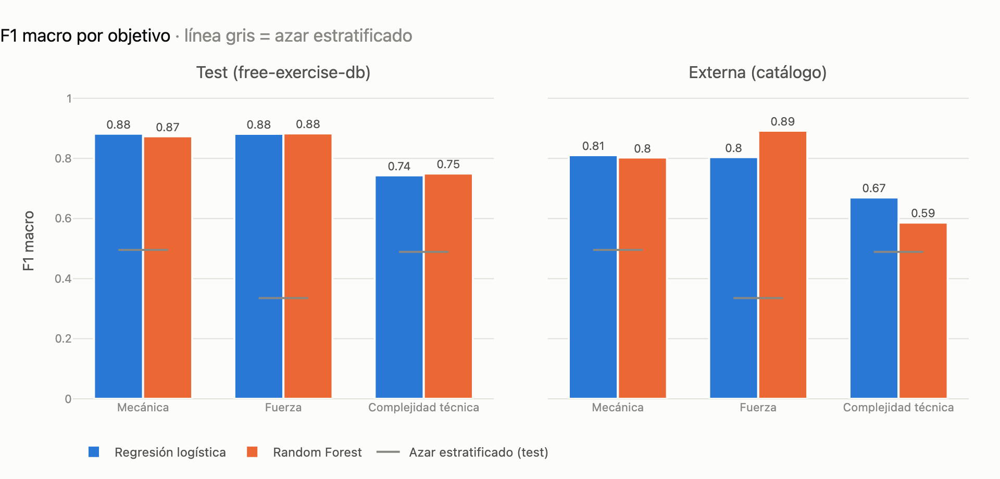

- **Mecánica** es un empate técnico con Random Forest (0,9004 frente a 0,9010 en CV). Gana
  la logística por simplicidad, y en el catálogo rinde igual o mejor (0,81 vs. 0,80).
- **Fuerza**: el Random Forest supera a la logística por más de un error estándar y es el
  único modelo que **no pierde rendimiento en el catálogo** (0,89 frente a 0,80).
- **Complejidad técnica** es claramente más difícil. Además, el Random Forest sobreajusta
  el estilo de free-exercise-db: cae a 0,59 en el catálogo.

**Qué aprendió cada modelo** (importancia por permutación agrupada, en test):

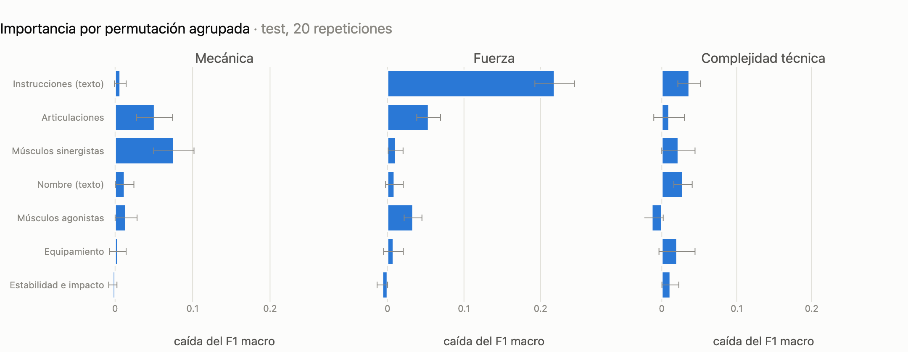

- **Mecánica se decide por la anatomía**: sinergistas y articulaciones. Es la definición
  biomecánica de "compuesto", y la mejor evidencia de que el modelo aprendió biomecánica
  y no palabras.
- **Fuerza se decide por las instrucciones** (verbos *push*, *pull*, *hold*).
- **Complejidad técnica no tiene una señal dominante** (ninguna familia supera 0,04 de
  caída). Confirma §11.5: es un juicio editorial, no una propiedad del movimiento.

### 12.4 Abstención y KPIs

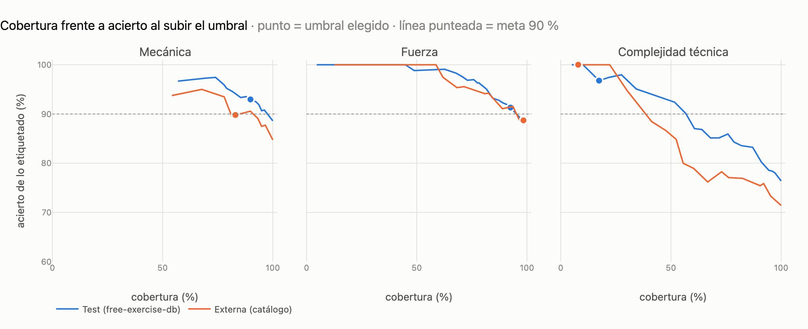

| KPI | Resultado |
|---|---|
| F1 macro en test ≥ 0,85 (mecánica y fuerza) | 0,88 / 0,88 ✅ |
| Acierto ≥ 90 % de lo etiquetado, en el catálogo | Mecánica 89,8 %, fuerza 88,5 %: en el límite, con una muestra de ~60 (±8 puntos) |
| Catálogo con mecánica (EV1 → §11 → §12) | 0 % → 23,1 % → **85,5 %** |
| Catálogo con fuerza | 0 % → 24,1 % → **95,5 %** |
| Catálogo con complejidad técnica | 0 % → 24,5 % → **32,9 %** (el modelo casi siempre se abstiene) |

En complejidad técnica, abstenerse es lo correcto: sin abstención el acierto en el
catálogo es 71 %, lo que significaría clasificar mal a uno de cada tres ejercicios.

**Aplicación.** Con complejidad baja conocida, sin impacto y sin inestabilidad, hay **609
ejercicios aptos para principiante** (287 del catálogo), y 244 de ellos tienen carga
graduable.

### 12.5 Recomendaciones y límites

1. Usar mecánica y fuerza en la sustitución por lesión de la fase 3: cubren el 85–96 % del
   catálogo con ~90 % de acierto.
2. Curar a mano la complejidad técnica del catálogo, empezando por los ejercicios en que
   el modelo tiene menos confianza (aprendizaje activo).
3. Exponer en la aplicación el origen (`fuente` / `transferida` / `modelo`) y la confianza
   de cada etiqueta, y permitir que un profesional la corrija.
4. Antes de producción, medir el acierto real con ~100 ejercicios del catálogo revisados
   a mano. La validación externa detecta la caída, pero no alcanza para certificar la
   meta.

**Límites.** Las etiquetas de free-exercise-db no están validadas clínicamente: el modelo
reproduce el criterio de esa fuente. Las reglas dependen de palabras clave y no detectan
un ejercicio de impacto cuyo nombre no lo describa.

### 12.6 Diagnóstico: cuánto confiar en los modelos

Nodo `diagnosticar_modelos` y sección 13 del notebook 02. Somete a los modelos ya
entrenados a pruebas más exigentes que la métrica principal. **No cambia ningún modelo ni
etiqueta**: es un informe de cómo se analizaron.

| Pregunta | Prueba | Resultado |
|---|---|---|
| ¿La diferencia entre algoritmos es real? | CV repetida 5 × 5 con los mismos pliegues, prueba t corregida de Nadeau-Bengio y McNemar | Ninguna supera el ruido. En fuerza, el Random Forest gana en el 80 % de los pliegues pero por 0,016 (t = 1,20, p = 0,24); en el catálogo difiere de la logística en 3 ejercicios (p = 0,25). Los dos algoritmos son equivalentes dentro del ruido |
| ¿Cuán inciertas son las métricas? | Intervalo *bootstrap* del 95 % | Test: 0,83–0,93 (mecánica), 0,82–0,93 (fuerza). Catálogo: 0,68–0,91 y 0,78–0,96. Con ~60 casos no se puede afirmar ni descartar la meta del 90 % |
| ¿La confianza es una probabilidad real? | Brier y curva de calibración | Sobre 0,9 los modelos aciertan 96–100 %. En tramos medios, mecánica promete de más y fuerza de menos (Brier del Random Forest 0,164 → 0,130 al recalibrar). No se recalibra: el umbral de abstención ya se eligió por acierto real |
| ¿Ordena bien la clase minoritaria? | PR-AUC frente a la prevalencia | `static`: 0,93 con prevalencia 0,12. Mecánica y fuerza > 0,87 en todas las clases |
| ¿Hay fuga de información? | Entrenar con la etiqueta barajada | El F1 cae al nivel del azar (0,50 / 0,31 / 0,54): no hay fuga |
| ¿El catálogo se parece a los datos de entrenamiento? | Validación adversarial | No: AUC 0,999. Las instrucciones bastan para distinguir la fuente, y también la anatomía (0,84): el catálogo anota más sinergistas que su gemelo (1,94 vs. 1,53) y usa otro vocabulario. Explica la caída en la validación externa |
| ¿Ayudarían más datos? | Curva de aprendizaje | Fuerza (0,83 → 0,91) y complejidad (0,69 → 0,75) siguen subiendo; mecánica está cerca de su techo (~0,89) |
| ¿La importancia depende del test? | Permutación agrupada en validación | No: mecánica = sinergistas y articulaciones; fuerza = instrucciones; complejidad = sin señal dominante |
| ¿Dónde se equivoca? | Revisión de los errores más seguros y casos explicados | Varios son errores de la etiqueta: *Lying Cambered Barbell Row* figura como aislado; *Leg-Up Hamstring Stretch*, como empuje. En fuerza, la confusión es empuje ↔ tracción en movimientos ambiguos (*pullover*, *windmill*) |
| ¿Qué tan buenas son las etiquetas? | Concordancia dentro de los grupos de variantes | Discordantes: 8 % (mecánica), 12 % (fuerza), **23,5 % (complejidad)**. Con ese ruido, un F1 de ~0,75 en complejidad está cerca del techo |

**Lo que cambia en la lectura de §12.3.** En fuerza el Random Forest se mantiene, porque
lo eligió la regla fijada antes de entrenar y es el único que no pierde rendimiento en el
catálogo, pero la defensa correcta es que **los dos algoritmos empatan dentro del ruido**.
La conclusión firme es otra: ningún modelo complejo supera claramente a la regresión
logística.

**Recomendaciones que agrega.**

1. Corregir las etiquetas discordantes de free-exercise-db antes de reentrenar: son pocas
   decenas de grupos y suben el techo de los tres modelos.
2. Si la aplicación muestra la confianza al usuario, recalibrar el modelo de fuerza con
   etiquetas del catálogo revisadas a mano: una calibración ajustada en free-exercise-db no
   vale para otra fuente.
3. Priorizar más etiquetas para fuerza y complejidad, que son las que mejorarían con más
   datos.

---

## 13. EV2 — Fase 3: Grafo biomecánico no supervisado

Pipeline `grafo_biomecanico` (§8.6). El desarrollo completo, con gráficos e
interpretación, está en
[`notebooks/03_modelado_no_supervisado.ipynb`](notebooks/03_modelado_no_supervisado.ipynb).

### 13.1 Pregunta de negocio

¿Qué **familias de movimiento** existen en el catálogo, y cuántas alternativas reales tiene
un ejercicio cuando se **veta una articulación lesionada**? Ninguna fuente trae una
taxonomía común de movimientos, así que las familias se descubren sin etiquetas. La
segunda pregunta es el KPI *Cobertura de sustitución* de §1.3 (meta ≥ 85 %).

### 13.2 El grafo

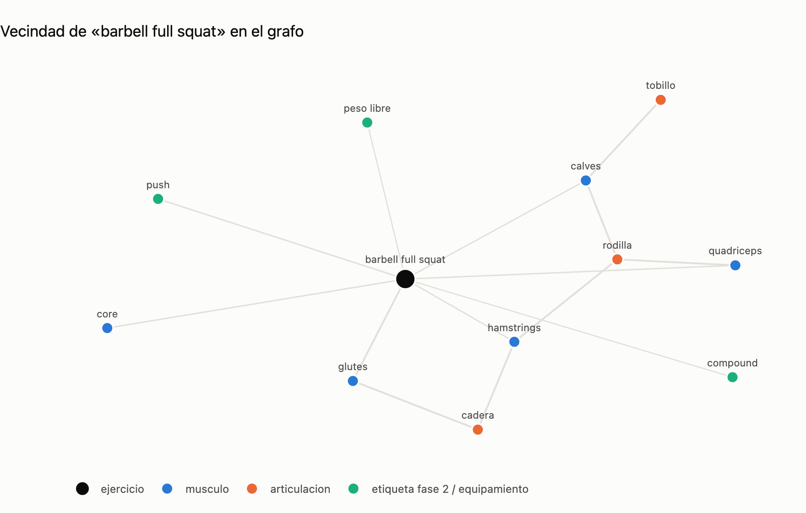

Grafo heterogéneo de **2.529 nodos y 13.907 aristas**: 2.461 ejercicios (se excluyen 131
sin músculos), 41 músculos y regiones, 13 articulaciones, 9 familias de equipamiento y
las etiquetas de fuerza y mecánica de la fase 2.

| Arista | Peso |
|---|---|
| Ejercicio → Músculo agonista / sinergista | 1,0 / 0,5 |
| Músculo → Articulación; Región → Músculo componente | 1,0 |
| Ejercicio → Fuerza / Mecánica / Equipamiento | 0,5 / 0,3 / 0,3 |

Un ejercicio **carga** una articulación si cualquiera de sus músculos, agonista **o**
sinergista, la cruza. En la sentadilla del catálogo el agonista es glúteo y el cuádriceps
es sinergista: mirando solo agonistas parecería segura para la rodilla.

**Segunda capa: carga por patrón de movimiento.** La primera capa depende de que la ficha
anote todos los músculos, y no siempre lo hace: *Kettlebell deadlifts* (wger) anota
glúteos, isquiotibiales, cuádriceps y trapecio, pero no la zona lumbar, y un peso muerto
la carga. Medido por el nombre, al 40 % de los ejercicios que cargan la columna lumbar
(peso muerto, *clean*, sentadilla con barra, remo inclinado) les faltaba esa articulación.
Por eso a la carga deducida de los músculos se le **suman** las articulaciones que el
nombre delata, según una tabla curada con patrón, articulación y motivo
(`data/01_raw/carga_por_patron.csv`). La regla solo agrega articulaciones, nunca las
quita, y no cambia las aristas del grafo: las familias de movimiento son las mismas. Toca
153 ejercicios, y cada uno guarda en `articulaciones_carga_patron` qué se le agregó.

### 13.3 Dos técnicas, comparadas

| | Louvain | Node2Vec + K-Means |
|---|---|---|
| Entrada | Proyección Ejercicio–Ejercicio (25 vecinos por coseno) | Grafo heterogéneo completo |
| Hiperparámetros | resolución 1,0 (máxima modularidad) | p = 1, q = 0,5, 16 dimensiones; k = 12 |
| Grupos | 24 | **12** |
| Modularidad (su vara) | **0,88** | 0,75 |
| *Silhouette* en el embedding (su vara) | 0,07 | **0,23** |
| AMI con la fuente (↓ mejor) | 0,17 | **0,08** |
| Cobertura de sustitución, misma familia | 57,1 % | **89,4 %** |

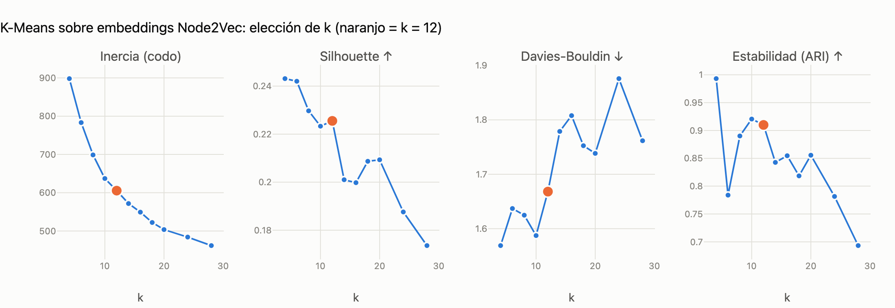

**k = 12** es el último k antes de que caiga la *silhouette* (0,23 → 0,20 en k = 14), con
estabilidad de 0,91 entre semillas (ARI). Reentrenando Node2Vec con otras semillas, la
partición se mantiene (ARI 0,83–0,84). El pipeline es reproducible: dos `kedro run` dan
salidas idénticas.

**Gana Node2Vec + K-Means.** Louvain es más fino y gana en modularidad, pero 8 de sus 24
comunidades tienen ≥ 90 % de una sola fuente: al proyectar por vecinos, cada ficha encuentra primero
a sus "hermanas" con el mismo vocabulario. Node2Vec recorre las aristas Región → Músculo
y mezcla las fuentes.

### 13.4 Las 12 familias de movimiento

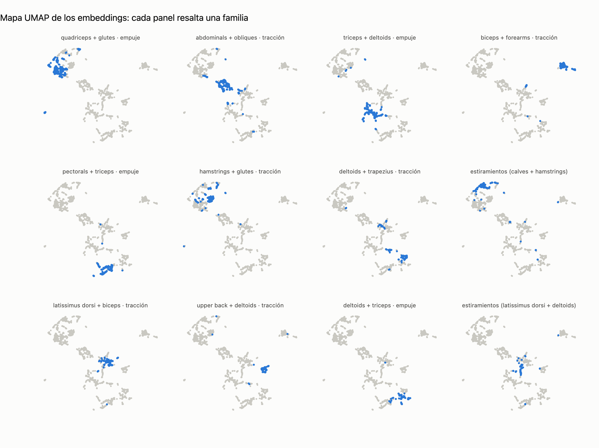

Cuádriceps-glúteo de empuje, isquiotibiales-glúteo de tracción, pecho, tríceps-hombro de
empuje, hombro de empuje, hombro-trapecio de tracción, dorsal, espalda alta, bíceps,
core y dos familias de estiramiento. Casi todas mezclan al menos dos fuentes:

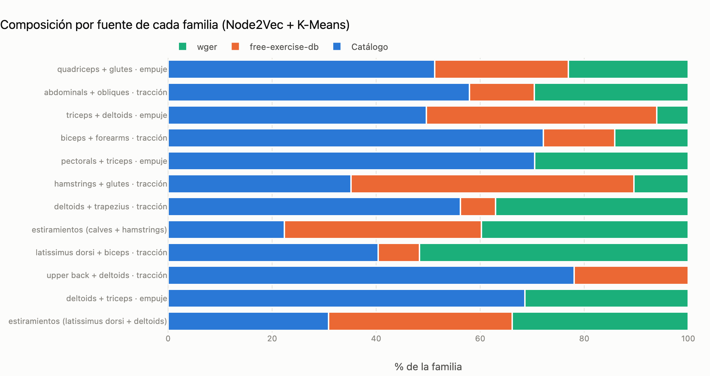

Los dos huecos son de **vocabulario**, no de movimiento: free-exercise-db anota `chest` y
`shoulders` (regiones), y sus ejercicios de pecho caen en la familia vecina de
tríceps-hombro; wger no usa `upper back`. Conectar cada ejercicio directo con los
componentes de su región (*fan-out*) se probó y empeoró la cobertura sin mejorar la
mezcla.

### 13.5 Sustitución con articulación vetada

Reglas (`Sustituidor`), en orden: (1) **no cargar** la articulación vetada; (2) conservar un
agonista del original que no la cruce; (3) abstenerse si esos músculos tienen < 10
ejercicios (§5.1 b); (4) fuerza por fuerza, estiramiento por estiramiento; (5) primero la
misma familia; (6) ordenar por similitud del embedding; (7) cuota de al menos una
alternativa de peso corporal en el top 5 (§5.1 a).

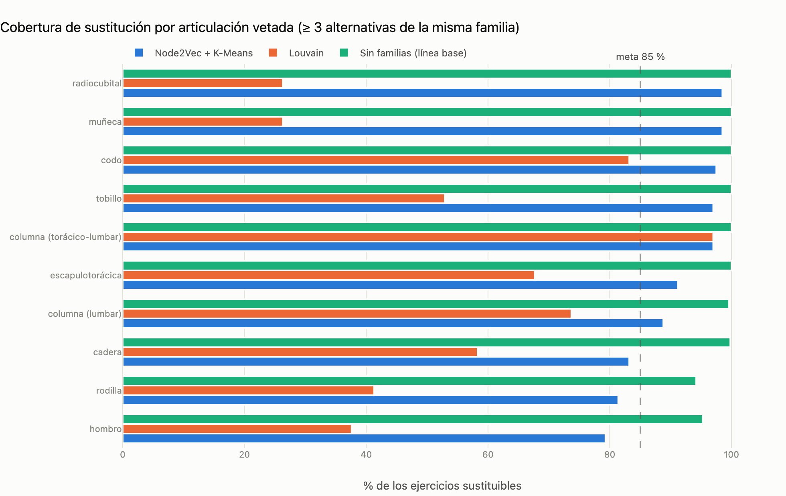

| KPI | Resultado |
|---|---|
| Casos (ejercicio × articulación que carga) | 6.652 |
| Sin sustituto **anatómico** (todos sus agonistas cruzan la articulación) | 2.652 (39,9 %): el sistema se abstiene |
| Abstención por músculo escaso | 16 (cuello y escápula) |
| **Cobertura de sustitución, misma familia** (sobre los 3.984 sustituibles) | **89,4 %** ✅ (meta 85 %) |
| Columna lumbar | 87,0 % (92,6 % antes de las correcciones de seguridad: esa cifra incluía alternativas que sí cargaban la lumbar) |
| Bajo la meta | hombro 79,6 %, rodilla 69,3 % (81,4 % antes de excluir los estiramientos; con alternativas de cualquier familia, 94,5 %), cadera 83,6 % |
| Listas con una alternativa sin equipamiento | 50 % → **98 %** con la cuota (gimnasio: 34 % → 98 %) |

- El **40 %** sin sustituto es anatomía, no un fallo del modelo: no existe un ejercicio de
  cuádriceps que no cargue la rodilla. La respuesta correcta es abstenerse y derivar.
- Las correcciones que siguieron a la revisión manual (carga por patrón, veto de la
  columna torácico-lumbar y reconocimiento de estiramientos, abajo) bajaron la cobertura
  de 91,0 % a 89,4 %: es el costo de no contar como válidas alternativas que no lo eran. Con la lumbar vetada, a un peso muerto rumano ya no se le propone *Kettlebell
  deadlifts* sino curl femoral o extensión de cadera en polea.
- Con la **rodilla** vetada, solo el 46 % de las alternativas mantiene el patrón de fuerza:
  la sentadilla (empuje) se reemplaza por ejercicios de cadera (puente, bisagra). La
  familia cuádriceps-glúteo tiene 443 ejercicios y solo 14 no cargan la rodilla: por eso la
  cobertura de la misma familia es 69,3 %, aunque con alternativas de cualquier familia
  llega a 94,5 %. La aplicación debe avisar que cambia el movimiento.

**Revisión manual de 30 recomendaciones.** El KPI mide que las alternativas sean seguras
según los datos, no que sirvan. El equipo revisó la primera alternativa de 30 casos (10 por
rodilla, hombro y columna lumbar vetados), con veredicto y comentario por caso, en
`data/01_raw/sustitucion_revision_manual.csv`:

| Veredicto | Rodilla | Hombro | Lumbar | Total |
|---|---|---|---|---|
| Bueno (un entrenador lo propondría) | 1 | 1 | 1 | **3** |
| Aceptable (mismo músculo; cambia patrón, equipo o dificultad) | 4 | 7 | 6 | **17** |
| Malo (seguro, pero no sirve como reemplazo) | 5 | 1 | 2 | **8** |
| Inseguro (carga la articulación vetada) | 0 | 1 | 1 | **2** |

- **20 de 30 (67 %) sirven** como reemplazo (bueno o aceptable). Con 30 casos el margen
  es amplio (IC 95 % ≈ 49–81 %): es una señal, no una certificación.
- **Los 2 inseguros se corrigieron y tienen test.** *Clean → Alternating Hang Clean* con el
  hombro vetado: en un *clean* la barra se recibe en rack sobre los hombros, así que la
  carga por patrón suma ahora el hombro. *Cable Woodchoppers → Upper External Oblique* con
  la lumbar vetada: la alternativa cargaba la columna torácico-lumbar, que el sistema
  trataba como otra articulación; vetar la lumbar ahora veta también la torácico-lumbar
  (`veto_incluye` en `parameters.yml`), y el sistema se abstiene.
- **La mitad de los malos también se corrigió.** 4 de los 8 proponían un estiramiento o
  una liberación miofascial como reemplazo de un ejercicio de fuerza (*Seated Pancake Good
  Morning*, *seated figure four*, *Foam Roller Gluteus*): sus nombres no dicen *stretch* y
  la regla "fuerza por fuerza, estiramiento por estiramiento" no los reconocía. Un patrón
  de nombres (`patron_estiramiento` en `parameters.yml`: *pancake*, *figure four*, *foam
  roll*, *yoga*, *pose*...) los marca ahora como estiramiento, y esos 4 casos reciben un
  ejercicio de fuerza (*Hip Thrust*, *Cable glute extension*, *Reverse Clamshell*). Los
  otros 4 malos (un *clean* reemplazado por un curl de muñeca, natación por natación de
  vuelta a la calma) no tienen una regla común y quedan como límite declarado.
- **Los aceptables cambian casi siempre la dificultad o el patrón** (piedras de Atlas →
  *good morning* sentado; *front lever* → activación abdominal). Es lo esperable con la
  articulación vetada, y refuerza la recomendación de avisar al usuario cuando cambia el
  movimiento.

**Demostración.** *Barbell full squat* con la rodilla vetada → **Hip Thrust** (similitud
0,90, misma familia). Con el perfil de principiante de la fase 2, el Hip Thrust sale de la
lista porque su complejidad técnica no está etiquetada (el modelo se abstuvo): la regla
exige complejidad conocida.

### 13.6 Recomendaciones y límites

1. Usar Node2Vec + K-Means como definición de familia, y mostrar en la aplicación si cada
   alternativa es "del mismo movimiento" u "otro movimiento".
2. Presentar la abstención como respuesta del producto ("no hay un sustituto seguro;
   consulta a un kinesiólogo"), no como error.
3. Validar clínicamente el mapeo músculo → articulación (§10, punto 1): la seguridad del
   recomendador descansa en él.
4. Armonizar `chest` / `shoulders` de free-exercise-db con los músculos del catálogo.
5. Curar la complejidad técnica de los ejercicios más recomendados, como el Hip Thrust.
6. Definir con un profesional una similitud mínima para ofrecer alternativas de otra
   familia.

**Límites.** Las familias reflejan cómo están **anotados** los ejercicios, no una medición
del movimiento. La *silhouette* moderada (0,23) indica fronteras difusas entre familias
vecinas.

---

## 14. EV2 — Evaluación integrada y recomendaciones de negocio

### 14.1 Cómo encajan los modelos

Los modelos de la EV2 no compiten entre sí: cada uno resuelve una parte del recomendador
y alimenta al siguiente.

```
Integración de fuentes (§11)        catálogo + free-exercise-db + wger → 2.592 ejercicios, ontología común
        │
        ▼
Modelos supervisados (§12)          completan mecánica, fuerza y complejidad técnica (con abstención)
        │                            → aristas Fuerza y Mecánica del grafo; filtro de principiante
        ▼
Grafo + Node2Vec + K-Means (§13)    12 familias de movimiento y un embedding por ejercicio
        │
        ▼
Sustitución con articulación vetada  reglas de seguridad → misma familia → orden por similitud
                                     → cuota sin equipamiento → o abstención explicada
```

### 14.2 Respuesta a los objetivos

| Objetivo (§1.2) | Resultado | Evidencia |
|---|---|---|
| 1. Integrar las fuentes en un solo grafo | 2.592 ejercicios sin duplicados, 41 músculos en vocabulario común, 2.461 en el grafo | §11, §13.2 |
| 2. Completar etiquetas con modelos supervisados | Mecánica y fuerza: F1 0,88 en test; catálogo con etiqueta 85,5 % y 95,5 % (antes 0 %). Complejidad: el modelo se abstiene en la mayoría, a propósito | §12.3, §12.4 |
| 3. Descubrir familias de movimiento | 12 familias interpretables que mezclan las tres fuentes (AMI con la fuente 0,08) | §13.3, §13.4 |
| 4. Sustituir con articulación vetada, o abstenerse | 89,4 % de los ejercicios sustituibles con ≥ 3 alternativas de su familia (meta 85 %); 39,9 % de los casos sin sustituto anatómico, con abstención. Revisión manual: 20 de 30 alternativas sirven | §13.5 |
| 5. Medir y mitigar sesgos | Cuota sin equipamiento: 50 % → 98 % de las listas; rehabilitación con complejidad conocida: 6,7 % → 65 %; sesgo nuevo contra wger detectado y declarado | §13.5, §14.3 |

### 14.3 Sesgo después del modelado

Detalle en `notebooks/03_modelado_no_supervisado.ipynb`, §12.

| Pregunta | Resultado |
|---|---|
| ¿Mejoró la cobertura de rehabilitación? | **Sí.** Complejidad técnica conocida: 6,7 % (EV1) → **65 %**, el contexto mejor cubierto. Sustitución en rehabilitación: 86,9 % (meta 85 %) |
| ¿Algún contexto quedó atrás? | *Cardio y otros*: sustitución 73,5 %, bajo la meta (muchos estiramientos y desplazamientos con pocos pares del mismo tipo) |
| ¿El modelo se equivoca más en algún contexto? | Mecánica: ≈ 78 % de acierto en rehabilitación frente a ≈ 91 % en gimnasio. Complejidad: ≈ 61 % en peso corporal. Muestras de 18 a 100: diferencias de menos de ~10 puntos no son concluyentes |
| ¿Y en alguna fuente? | **wger** queda peor etiquetada (fuerza 69 %, complejidad 11,5 %): el modelo se abstiene más con sus instrucciones cortas, y el perfil de principiante casi no recomienda ejercicios de wger. Es un sesgo **creado por la abstención** |
| ¿El ranking favorece el gimnasio? | Sin corrección, sí: solo el 34 % de las listas del gimnasio traía una opción sin equipamiento. Con la cuota, el 98 % |

La abstención protege la **calidad** de las etiquetas, pero redistribuye la **cobertura**:
los contextos y fuentes más difíciles de etiquetar son los que menos se recomiendan. Es
el costo de fallar hacia la abstención, y se corrige curando datos, no bajando el umbral.

### 14.4 Recomendaciones de negocio

Ordenadas por cuándo deben hacerse.

**En el producto, desde la primera versión**

1. **Presentar la abstención como respuesta**: "no hay un sustituto seguro para este
   ejercicio; consulta a un kinesiólogo". En el 40 % de los casos con una articulación
   vetada es la única respuesta honesta.
2. **Decir cuándo cambia el movimiento.** Cada alternativa se marca como "mismo
   movimiento" (misma familia) u "otro movimiento". Con la rodilla vetada, la alternativa
   segura casi siempre pasa de sentadilla a puente o bisagra de cadera.
3. **Mostrar el origen y la confianza de cada etiqueta** (fuente, transferida o modelo),
   y permitir que un profesional la corrija.
4. **Mantener activa la cuota sin equipamiento**: cuesta un lugar del top 5 y saca al
   recomendador del sesgo hacia el gimnasio.

**Antes de producción**

5. **Validar clínicamente el mapeo músculo → articulación** con un profesional de la
   salud. Toda la seguridad de la sustitución descansa en él (§10, punto 1).
6. **Revisar a mano** ~100 etiquetas del catálogo y ~30 recomendaciones con rodilla,
   hombro y columna lumbar vetadas: la validación externa detecta caídas, pero no
   alcanza para certificar las metas.
7. **Definir una similitud mínima** para ofrecer alternativas de otra familia (hoy se
   ofrecen todas las que cumplen las reglas de seguridad).

**En los datos**

8. **Curar la complejidad técnica** de los ejercicios más recomendados, empezando por
   los de wger y por los que el modelo deja sin etiqueta (como el Hip Thrust).
9. **Armonizar `chest` / `shoulders`** de free-exercise-db con `pectorals` / `deltoids`
   en la ontología, para cerrar el hueco de mezcla de fuentes en las familias de pecho y
   hombro.
10. **Ampliar el reconocimiento de estiramientos y movilidad** más allá del patrón de
    nombres de §13.5, idealmente con una etiqueta curada en la fuente: el patrón resolvió
    4 de los 8 reemplazos malos de la revisión manual, pero depende del nombre.

### 14.5 Próximos pasos tras la EV2

| Paso | Por qué | Fase CRISP-DM |
|---|---|---|
| Validación clínica del mapeo articular | Prerrequisito de seguridad para producción | 2–3 (datos) |
| Revisión humana de etiquetas y recomendaciones | Certificar los KPIs de acierto con una muestra real | 5 (evaluación) |
| Subir hombro, rodilla y cadera sobre el 85 % | Las tres articulaciones más consultadas están en 69–84 % | 4 (modelado) |
| API de recomendación y aplicación con pose en el dispositivo | Medir los KPIs de latencia y privacidad, hoy sin medir | 6 (despliegue), §7 |
